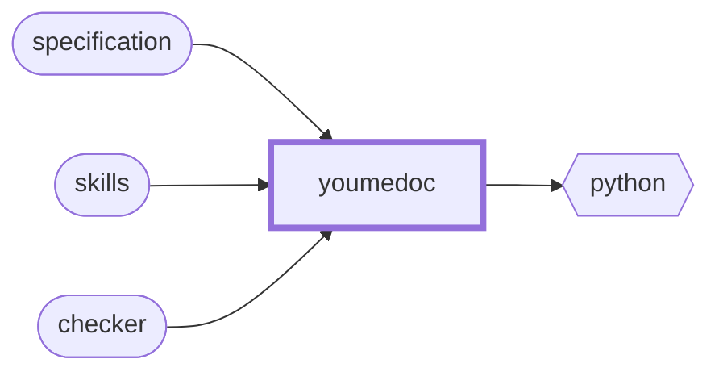

<!-- youmedoc:generated - do not edit; run `youmedoc generate` -->
# Context diagram: youmedoc

[youmedoc](../../README.md)

`youmedoc` and the outside world: the ports it provides (rounded) and the things it needs from outside (hexagons).

| Port | Direction | Kind | Summary |
|---|---|---|---|
| specification | provided | specification | The text of the standard, in chapters of at most 200 lines |
| skills | provided | skill | Three skills that teach an agent to read, write and check a youmedoc project |
| checker | provided | cli | Reference tool that checks the mechanical rules and generates diagrams and indexes |
| python | needed | runtime | Python 3.9 or newer with PyYAML, to run the checker |
