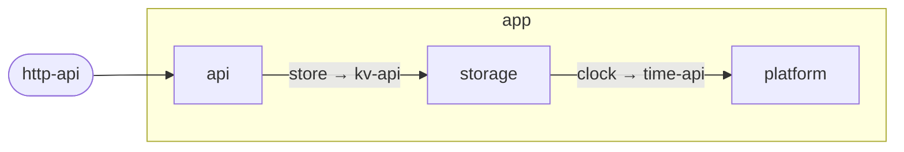

# Diagrams

Structural diagrams are generated from the [manifests](manifest.md). Nobody
draws them by hand. They are Mermaid flowcharts inside Markdown files, so they
render on common code hosting platforms and in editors.

## The three diagrams

Each unit gets up to three files in `doc/diagrams/`:

| File | Shows | Generated for |
|---|---|---|
| `context.md` | The unit among its siblings inside its parent. Only connections that touch the unit are drawn. | every unit |
| `component.md` | The direct children of the unit and all wiring between them. | units with children |
| `architecture.md` | The unit next to its siblings, opened up three levels down. | units with children |

For the root unit, `context.md` shows the project and the outside world: its
provided ports and its needs. Its `architecture.md` shows the whole project
three levels deep.

The name `architecture.md` exists twice in a unit. `doc/architecture.md` is the
hand-written explanation ([doc-folder.md](doc-folder.md)).
`doc/diagrams/architecture.md` is the generated diagram.

## How to read a diagram

- A box is a unit. A frame around boxes is a unit that is opened up.
- An arrow points from the side that needs something to the side that
  provides it. The label is the need. If the provider's port has another name,
  the label reads `need → port`.
- A rounded node is a port that the framing unit provides to the outside. A
  hexagon is a need of the framing unit.
- A dashed arrow is one of several alternative providers.
- A dashed border marks a unit with `status: planned`.
- The unit the diagram is about has a thick border.

In an opened-up unit, arrows end at the innermost visible unit that implements
or uses the port. If the unit does not delegate the port to a child, the arrow
ends at the frame.

## Drilling down

Below each diagram is a table with one row per unit shown. Each row links to
the unit's `README.md` and to its most detailed diagram. Follow these links to
move down or up the tree.

The boxes also carry click targets that lead to the `README.md` of the unit.
Not every Markdown renderer honours them. The table always works.

## Example

Given this parent manifest:

```yaml
unit: app
provides:
  http-api: {kind: http, summary: The public API}
wiring:
  http-api: api.http-api
  api.store: storage.kv-api
  storage.clock: platform.time-api
```

`app/doc/diagrams/component.md` contains:



## Generated files

- A generated file starts with a marker comment that begins with
  `<!-- youmedoc:generated`.
- Generated files MUST NOT be edited. Change the manifests and regenerate.
- Generated files are committed to the repository. They are what a reader
  sees when browsing the folder tree.
- `doc/diagrams/` MUST NOT contain hand-written files.
- The 200-line limit applies. If the architecture diagram of a unit would
  exceed it, the generator opens up fewer levels and says so in the file.
- The link rules do not apply to generated files. A context diagram links to
  the parent and to siblings; that is allowed because the file is derived.

The second kind of generated file is the decision index,
`doc/decisions/index.md` ([doc-folder.md](doc-folder.md)).

## When to regenerate

After every change to a manifest, a decision record's title or status, or the
folder tree. The [checker](checker.md) reports missing and stale generated
files. After moving or copying a unit, regenerate: the context diagram of the
unit depends on where it sits.

## Hand-drawn diagrams

Some views cannot be derived from the manifests: a sequence of calls, a state
machine, a deployment layout. Draw them as Mermaid in `doc/architecture.md` or
in a reference. They MUST NOT repeat what the generated diagrams show.

In such a diagram the participants may be the unit's direct children, by
name, and things outside the unit. Show what passes between participants.
Do not show what happens inside a child.

## Linking to diagrams

`README.md` SHOULD link to `doc/diagrams/context.md`. `AGENTS.md` SHOULD link
to `doc/diagrams/component.md` when it exists. All generated files of a unit
link to each other and back to the unit's `README.md`.
