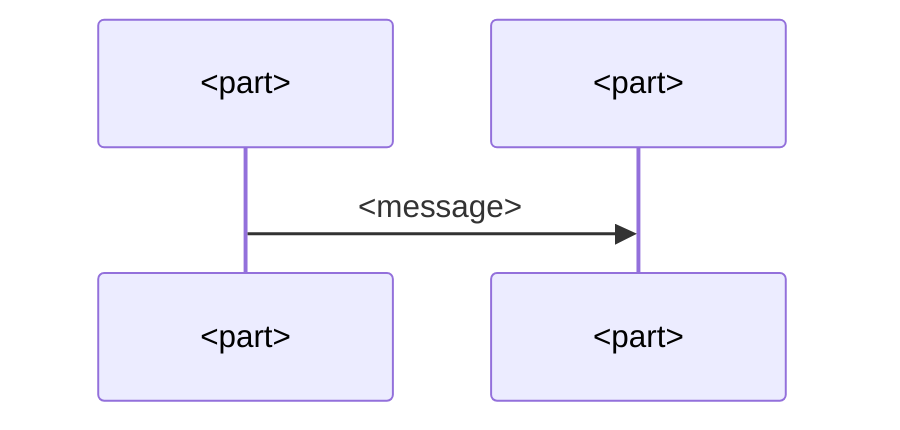

# Runtime of <folder-name>

<Scenarios that cross several parts and that no single part can tell: a sequence, a state machine, the order of a start. Mermaid, drawn by hand.>

## <Scenario>

<One sentence: what the picture shows and which parts appear.>

