# Architecture of cloud

The long form of the why in [AGENTS.md](../AGENTS.md). Which services exist
and how they are wired is shown in the
[component diagram](diagrams/component.md).

## Reasoning

**Accepting is separated from using.** A client is online rarely and
briefly. The moment it uploads is the only chance to take its readings, so
that path has as few dependencies as possible. The service that accepts
readings validates them, recognises duplicates and announces each reading as
an event. It calls nobody
([0001](decisions/0001-services-learn-about-readings-through-events.md)).
It is also the only service that depends on the format of an uploaded
reading. The others see readings only as events.

**History and alerts are separate consumers.** Both follow the same events
and neither waits for the other. A slow history query does not delay an
alert, and a fault in evaluation does not lose history. Each consumer keeps
its own position on the event stream and catches up after a restart.

**Evaluation asks for thresholds instead of copying them.** Thresholds
change rarely and must be current when a reading is judged. A call for the
plant of a reading is simpler than a second event stream for plant changes,
and a short outage of the registry only delays evaluation, because the
reading waits on the event bus.

**Data is private to a service.** Two services never share a table. What one
needs from another is a port
([0002](decisions/0002-each-service-owns-its-data.md)). This keeps a schema
change inside one service.

**One door.** Authentication happens once, at the only service that is
reachable from outside
([0003](decisions/0003-one-gateway-is-the-only-public-entry.md)). The
services behind it stay free of token handling and are told the owner they
act for ([service calls](references/service-calls.md)).

**Shared infrastructure has an owner.** The event bus and the database are
operated in one place, [platform](../platform/README.md). The services state
what they need from it and do not configure it themselves.

## Invariants

- A reading that an upload reports as new or duplicate is on the event bus
  and reaches every subscriber, also one that is down at that moment.
- An upload calls no service other than the one that accepts readings.
- No service reads or writes the database schema of another service.
- No container other than the public entry is reachable from outside the
  private network.
- Every event consumer produces the same result when an event arrives twice
  ([0004](decisions/0004-every-event-consumer-is-idempotent.md)).
- Events of one sensor stick are processed in the order in which their
  readings were accepted.
- Only [alerts](../services/alerts/README.md) decides that a plant needs
  attention, and only it talks to the push service.

## An upload that leads to an alert

The sequence crosses several services and is therefore drawn here. It shows
the direct children of `cloud` and the outside world.

```mermaid
sequenceDiagram
    participant C as client
    participant G as gateway
    participant I as ingest
    participant B as platform (event bus)
    participant P as plants
    participant A as alerts
    participant N as push service
    C->>G: upload batch, with token
    G->>G: verify token
    G->>I: batch, with owner id
    I->>I: validate, recognise duplicates
    I->>B: publish one event per new reading
    B-->>I: stored
    I-->>G: result per reading
    G-->>C: result per reading
    par history
        B->>P: reading event
        P->>P: add to history of the plant
    and evaluation
        B->>A: reading event
        A->>P: plant and thresholds of this sensor stick
        P-->>A: plant, owner, thresholds
        A->>A: evaluate, open or close alerts
        opt an alert has opened
            A->>N: one notification for the owner
        end
    end
    C->>G: query alerts and history
    G->>A: alerts of the owner
    G->>P: history of a plant
```

The upload is answered before history and evaluation have seen the reading.
The two branches run independently and in any order.

## Where things run

Every service is one container image. The table shows what the folder tree
cannot: how many instances run and what must survive a restart.

| Part | Instances | Volume | Reachable from outside |
|---|---|---|---|
| [gateway](../services/gateway/README.md) | 2 or more | none | yes, one port |
| [ingest](../services/ingest/README.md) | 2 or more | none | no |
| [plants](../services/plants/README.md) | 1 or more | none | no |
| [alerts](../services/alerts/README.md) | 1 or more | none | no |
| [platform](../platform/README.md) | 1 per container | yes | no |

Consequences:

- Every service can be stopped and started without losing data. All durable
  state is in [platform](../platform/README.md).
- A service image is replaced by starting new instances before the old ones
  stop. Events that arrive in between wait on the event bus.
- [platform](../platform/README.md) is the single point of failure of
  version 1. While it is down, uploads are refused with `unavailable` and
  the client keeps its readings.

## Trade-offs

- A query does not see a reading at the moment the upload returns. The
  public API states this limit.
- Evaluation depends on a synchronous call for thresholds. The alternative,
  a copy of the thresholds kept current through events, is rejected for
  version 1 in
  [0001](decisions/0001-services-learn-about-readings-through-events.md).
- Five deployable parts for a small product cost more operation than one
  program. The gain is that the upload path stays up while the rest
  changes.
