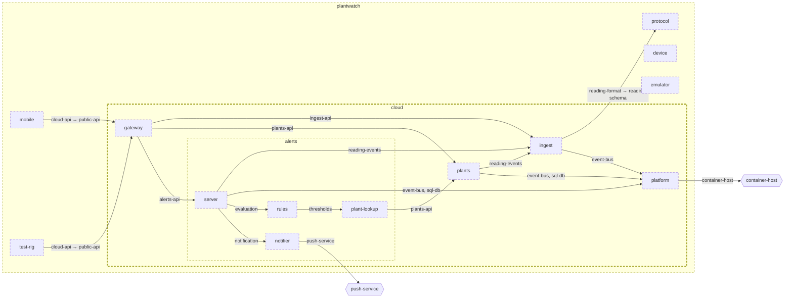

<!-- youmedoc:generated - do not edit; run `youmedoc generate` -->
# Architecture diagram: cloud

[plantwatch](../../../doc/diagrams/component.md) / **cloud** · [README](../../README.md) · [context](context.md) · [component](component.md)

`cloud` next to its siblings in `plantwatch`, opened up 3 level(s) down. Arrows point from the side that needs something to the side that provides it. Rounded nodes are ports the framing unit provides, hexagons are its needs. A dashed arrow is an alternative provider; a dashed border marks a planned unit.

| Unit | Kind | Diagram |
|---|---|---|
| [plantwatch](../../../README.md) | system | [component](../../../doc/diagrams/component.md) |
| [cloud](../../README.md) | system | [component](component.md) |
| [platform](../../platform/README.md) | infrastructure | [context](../../platform/doc/diagrams/context.md) |
| [alerts](../../services/alerts/README.md) | service | [component](../../services/alerts/doc/diagrams/component.md) |
| [notifier](../../services/alerts/notifier/README.md) | adapter | [context](../../services/alerts/notifier/doc/diagrams/context.md) |
| [plant-lookup](../../services/alerts/plant-lookup/README.md) | adapter | [context](../../services/alerts/plant-lookup/doc/diagrams/context.md) |
| [rules](../../services/alerts/rules/README.md) | library | [context](../../services/alerts/rules/doc/diagrams/context.md) |
| [server](../../services/alerts/server/README.md) | app | [context](../../services/alerts/server/doc/diagrams/context.md) |
| [gateway](../../services/gateway/README.md) | service | [context](../../services/gateway/doc/diagrams/context.md) |
| [ingest](../../services/ingest/README.md) | service | [context](../../services/ingest/doc/diagrams/context.md) |
| [plants](../../services/plants/README.md) | service | [context](../../services/plants/doc/diagrams/context.md) |
| [device](../../../device/README.md) | firmware | [component](../../../device/doc/diagrams/component.md) |
| [emulator](../../../emulator/README.md) | tool | [context](../../../emulator/doc/diagrams/context.md) |
| [mobile](../../../mobile/README.md) | app | [component](../../../mobile/doc/diagrams/component.md) |
| [protocol](../../../protocol/README.md) | specification | [context](../../../protocol/doc/diagrams/context.md) |
| [test-rig](../../../test-rig/README.md) | test | [context](../../../test-rig/doc/diagrams/context.md) |
