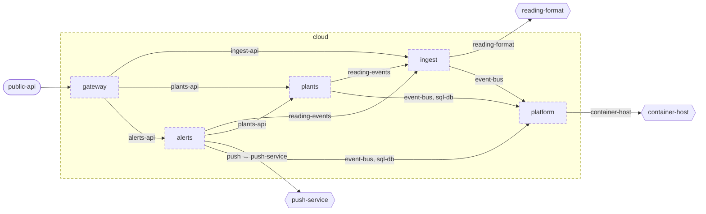

<!-- youmedoc:generated - do not edit; run `youmedoc generate` -->
# Component diagram: cloud

[plantwatch](../../../doc/diagrams/component.md) / **cloud** · [README](../../README.md) · [context](context.md) · [architecture](architecture.md)

The units directly inside `cloud` and how they are wired. Arrows point from the side that needs something to the side that provides it. Rounded nodes are ports the framing unit provides, hexagons are its needs. A dashed arrow is an alternative provider; a dashed border marks a planned unit.

| Unit | Kind | Summary | Status | Diagram |
|---|---|---|---|---|
| [cloud](../../README.md) | system | Server side that turns uploaded readings into plant history and alerts | planned | [component](component.md) |
| [platform](../../platform/README.md) | infrastructure | Shared infrastructure of the services - message bus and database | planned | [context](../../platform/doc/diagrams/context.md) |
| [alerts](../../services/alerts/README.md) | service | Decides when a plant needs attention and notifies its owner once | planned | [component](../../services/alerts/doc/diagrams/component.md) |
| [gateway](../../services/gateway/README.md) | service | Single entry point of the server side that authenticates callers and routes requests | planned | [context](../../services/gateway/doc/diagrams/context.md) |
| [ingest](../../services/ingest/README.md) | service | Accepts uploaded readings and announces each accepted one as an event | planned | [context](../../services/ingest/doc/diagrams/context.md) |
| [plants](../../services/plants/README.md) | service | Registry of plants with their sensors, thresholds and reading history | planned | [context](../../services/plants/doc/diagrams/context.md) |
