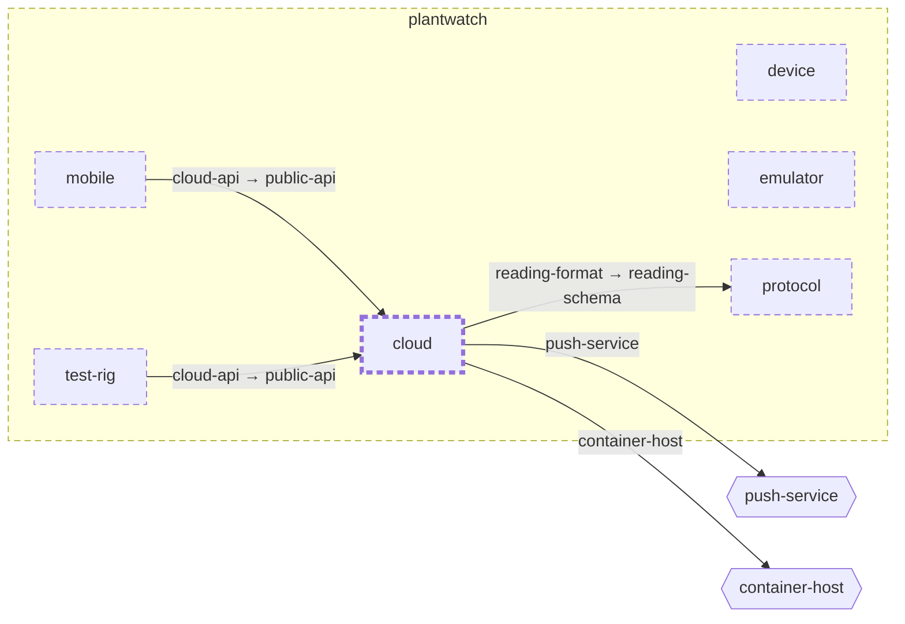

<!-- unifold:generated - do not edit; run `unifold generate` -->
# Context diagram: cloud

[plantwatch](../../../doc/diagrams/component.md) / **cloud** · [README](../../README.md) · [component](component.md) · [architecture](architecture.md)

`cloud` among its siblings inside `plantwatch`. Only connections that touch `cloud` are drawn. Arrows point from the side that needs something to the side that provides it. Rounded nodes are ports the framing unit provides, hexagons are its needs. A dashed arrow is an alternative provider; a dashed border marks a planned unit.

| Unit | Kind | Diagram |
|---|---|---|
| [plantwatch](../../../README.md) | system | [component](../../../doc/diagrams/component.md) |
| [cloud](../../README.md) | system | [component](component.md) |
| [device](../../../device/README.md) | firmware | [component](../../../device/doc/diagrams/component.md) |
| [emulator](../../../emulator/README.md) | tool | [context](../../../emulator/doc/diagrams/context.md) |
| [mobile](../../../mobile/README.md) | app | [component](../../../mobile/doc/diagrams/component.md) |
| [protocol](../../../protocol/README.md) | specification | [context](../../../protocol/doc/diagrams/context.md) |
| [test-rig](../../../test-rig/README.md) | test | [context](../../../test-rig/doc/diagrams/context.md) |

### Who provides what this unit needs

| Need | Kind | Own contract | Provided by | Port | Their contract |
|---|---|---|---|---|---|
| push-service | http |  | outside the project, as need `push-service` of the root | | |
| reading-format | specification |  | [protocol](../../../protocol/README.md) | reading-schema | [contract](../../../protocol/doc/references/reading-schema.md) |
| container-host | infrastructure |  | outside the project, as need `container-host` of the root | | |

### Who uses what this unit provides

| Port | Kind | Used by | As need | Their contract |
|---|---|---|---|---|
| public-api | http | [mobile/sync](../../../mobile/sync/README.md) | cloud-api |  |
| public-api | http | [test-rig](../../../test-rig/README.md) | cloud-api |  |
