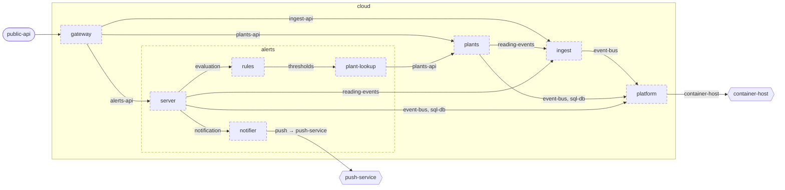

<!-- unifold:generated - do not edit; run `unifold generate` -->
# Architecture diagram: cloud

[plantwatch](../../../docs/diagrams/component.md) / **cloud** · [README](../../README.md) · [context](context.md) · [component](component.md)

`cloud` opened up 3 levels deep. An arrow points from the unit that needs something to the unit that provides it. Rounded nodes are capabilities of the framing unit, hexagons are its needs. A dashed arrow is an alternative provider; a dashed border marks a unit that is planned.

| Unit | Kind | Summary | Status | Diagram |
|---|---|---|---|---|
| [platform](../../platform/README.md) | infrastructure | Shared infrastructure of the services - message bus and database | **planned** | [context](../../platform/docs/diagrams/context.md) |
| [alerts](../../services/alerts/README.md) | service | Decides when a plant needs attention and notifies its owner once | **planned** | [component](../../services/alerts/docs/diagrams/component.md) |
| [notifier](../../services/alerts/notifier/README.md) | adapter | Turns an opened alert into one notification to the owner | **planned** | [context](../../services/alerts/notifier/docs/diagrams/context.md) |
| [plant-lookup](../../services/alerts/plant-lookup/README.md) | adapter | Looks up the plant a sensor stick is attached to, with owner and thresholds, in the registry of plants | **planned** | [context](../../services/alerts/plant-lookup/docs/diagrams/context.md) |
| [rules](../../services/alerts/rules/README.md) | library | Evaluates readings against the thresholds of a plant | **planned** | [context](../../services/alerts/rules/docs/diagrams/context.md) |
| [server](../../services/alerts/server/README.md) | app | Process that consumes readings, stores the alerts they lead to and answers queries about them | **planned** | [context](../../services/alerts/server/docs/diagrams/context.md) |
| [gateway](../../services/gateway/README.md) | service | Single entry point of the server side that authenticates callers and routes requests | **planned** | [context](../../services/gateway/docs/diagrams/context.md) |
| [ingest](../../services/ingest/README.md) | service | Accepts uploaded readings and announces each accepted one as an event | **planned** | [context](../../services/ingest/docs/diagrams/context.md) |
| [plants](../../services/plants/README.md) | service | Registry of plants with their sensors, thresholds and reading history | **planned** | [context](../../services/plants/docs/diagrams/context.md) |
