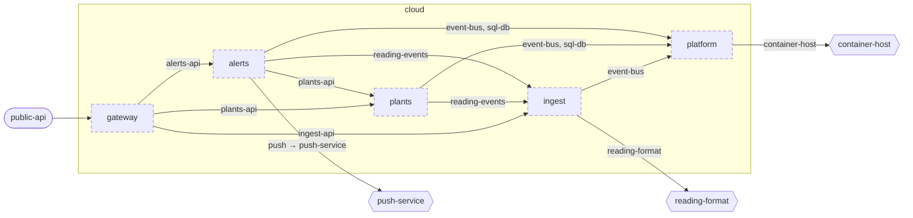

<!-- unifold:generated - do not edit; run `unifold generate` -->
# Component diagram: cloud

[plantwatch](../../../docs/diagrams/component.md) / **cloud** · [README](../../README.md) · [context](context.md) · [architecture](architecture.md)

The units directly inside `cloud` and how they are connected. An arrow points from the unit that needs something to the unit that provides it. Rounded nodes are capabilities of the framing unit, hexagons are its needs. A dashed arrow is an alternative provider; a dashed border marks a unit that is planned.

| Unit | Kind | Summary | Status | Diagram |
|---|---|---|---|---|
| [platform](../../platform/README.md) | infrastructure | Shared infrastructure of the services - message bus and database | **planned** | [context](../../platform/docs/diagrams/context.md) |
| [alerts](../../services/alerts/README.md) | service | Decides when a plant needs attention and notifies its owner once | **planned** | [component](../../services/alerts/docs/diagrams/component.md) |
| [gateway](../../services/gateway/README.md) | service | Single entry point of the server side that authenticates callers and routes requests | **planned** | [context](../../services/gateway/docs/diagrams/context.md) |
| [ingest](../../services/ingest/README.md) | service | Accepts uploaded readings and announces each accepted one as an event | **planned** | [context](../../services/ingest/docs/diagrams/context.md) |
| [plants](../../services/plants/README.md) | service | Registry of plants with their sensors, thresholds and reading history | **planned** | [context](../../services/plants/docs/diagrams/context.md) |

### Connections

| Need | Provider | Note |
|---|---|---|
| capability `public-api` of `cloud` | `gateway.public-api` | implemented by |
| `ingest.event-bus` | `platform.event-bus` |  |
| `plants.event-bus` | `platform.event-bus` |  |
| `alerts.event-bus` | `platform.event-bus` |  |
| `plants.sql-db` | `platform.sql-db` |  |
| `alerts.sql-db` | `platform.sql-db` |  |
| `gateway.ingest-api` | `ingest.ingest-api` |  |
| `gateway.plants-api` | `plants.plants-api` |  |
| `gateway.alerts-api` | `alerts.alerts-api` |  |
| `plants.reading-events` | `ingest.reading-events` |  |
| `alerts.reading-events` | `ingest.reading-events` |  |
| `alerts.plants-api` | `plants.plants-api` |  |
| `alerts.push` | need `push-service` of `cloud` |  |
| `platform.container-host` | need `container-host` of `cloud` | passed up by name |
| `ingest.reading-format` | need `reading-format` of `cloud` | passed up by name |
