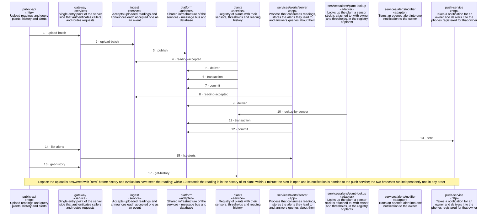

<!-- unifold:generated - do not edit; run `unifold generate` -->
# Scenario: upload-leads-to-alert

[plantwatch](../../../docs/diagrams/component.md) / **cloud** · [README](../../README.md) · [context](context.md) · [component](component.md) · [architecture](architecture.md)

**An upload is accepted, enters the history, is judged and opens an alert**
Source: decisions 0001 and 0003 of cloud
Expect: the upload is answered with `new` before history and evaluation have seen the reading; within 10 seconds the reading is in the history of its plant; within 1 minute the alert is open and its notification is handed to the push service; the two branches run independently and in any order

A unit is named by its path from `cloud`; a capability or need of `cloud` is named bare. Every hop is a call along one connection of the map.

| # | Caller | Target | Part | Contract |
|---|---|---|---|---|
| 1 | `public-api` | `gateway` | `upload-batch` | [index](../../../docs/references/public-api/index.md) |
| 2 | `gateway` | `ingest` | `upload-batch` | [ingest-api](../references/ingest-api.md) |
| 3 | `ingest` | `platform` | `publish` | [event-bus](../references/event-bus.md) |
| 4 | `plants` | `ingest` | `reading-accepted` | [reading-events](../references/reading-events.md) |
| 5 | `plants` | `platform` | `deliver` | [event-bus](../references/event-bus.md) |
| 6 | `plants` | `platform` | `transaction` | [sql-db](../references/sql-db.md) |
| 7 | `plants` | `platform` | `commit` | [event-bus](../references/event-bus.md) |
| 8 | `services/alerts/server` | `ingest` | `reading-accepted` | [reading-events](../references/reading-events.md) |
| 9 | `services/alerts/server` | `platform` | `deliver` | [event-bus](../references/event-bus.md) |
| 10 | `services/alerts/plant-lookup` | `plants` | `lookup-by-sensor` | [plants-api](../references/plants-api.md) |
| 11 | `services/alerts/server` | `platform` | `transaction` | [sql-db](../references/sql-db.md) |
| 12 | `services/alerts/server` | `platform` | `commit` | [event-bus](../references/event-bus.md) |
| 13 | `services/alerts/notifier` | `push-service` | `send` | [push-service](../../../docs/references/push-service.md) |
| 14 | `public-api` | `gateway` | `list-alerts` | [index](../../../docs/references/public-api/index.md) |
| 15 | `gateway` | `services/alerts/server` | `list-alerts` | [alerts-api](../references/alerts-api.md) |
| 16 | `public-api` | `gateway` | `get-history` | [index](../../../docs/references/public-api/index.md) |
| 17 | `gateway` | `plants` | `get-history` | [plants-api](../references/plants-api.md) |
