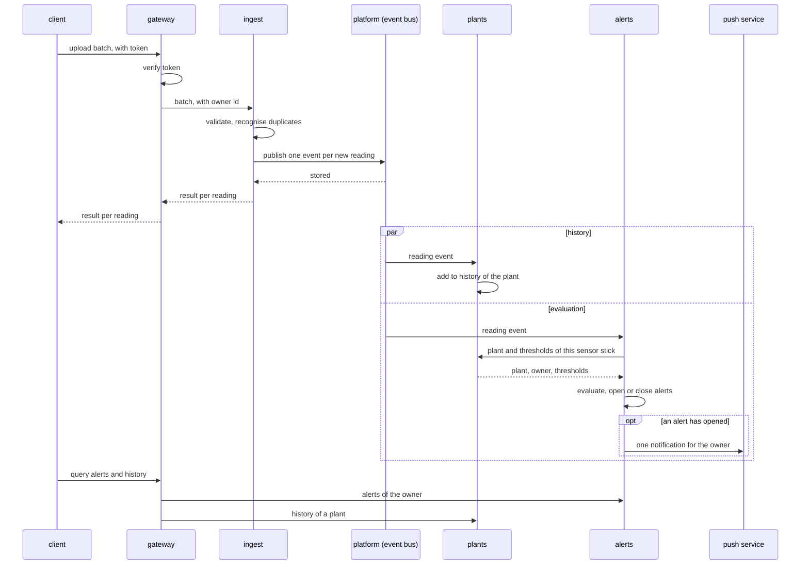

# Runtime of cloud

Scenarios that cross several services and that no single service can tell. Which services exist is in the [component diagram](../diagrams/component.md).

## An upload that leads to an alert

The sequence crosses several services and is therefore drawn here. It shows the direct children of `cloud` and the outside world.

The upload is answered before history and evaluation have seen the reading. The two branches run independently and in any order.
