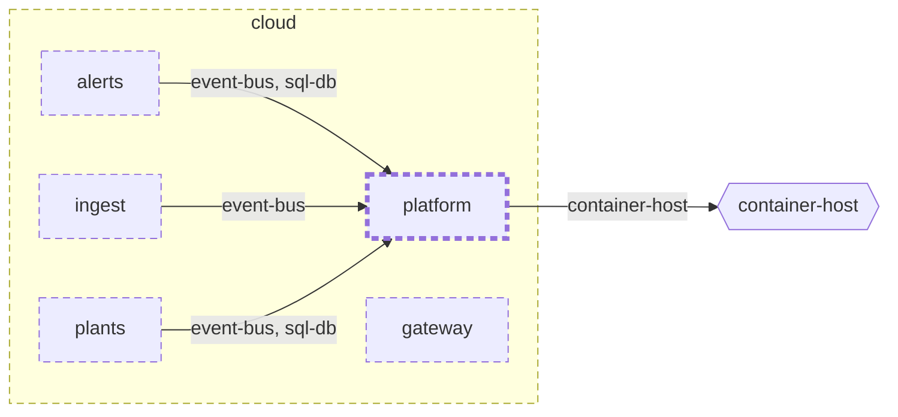

<!-- unifold:generated - do not edit; run `unifold generate` -->
# Context diagram: platform

[plantwatch](../../../../doc/diagrams/component.md) / [cloud](../../../doc/diagrams/component.md) / **platform** · [README](../../README.md)

`platform` among its siblings inside `cloud`. Only connections that touch `platform` are drawn. Arrows point from the side that needs something to the side that provides it. Rounded nodes are ports the framing unit provides, hexagons are its needs. A dashed arrow is an alternative provider; a dashed border marks a planned unit.

| Unit | Kind | Diagram |
|---|---|---|
| [cloud](../../../README.md) | system | [component](../../../doc/diagrams/component.md) |
| [platform](../../README.md) | infrastructure | [context](context.md) |
| [alerts](../../../services/alerts/README.md) | service | [component](../../../services/alerts/doc/diagrams/component.md) |
| [gateway](../../../services/gateway/README.md) | service | [context](../../../services/gateway/doc/diagrams/context.md) |
| [ingest](../../../services/ingest/README.md) | service | [context](../../../services/ingest/doc/diagrams/context.md) |
| [plants](../../../services/plants/README.md) | service | [context](../../../services/plants/doc/diagrams/context.md) |

### Who provides what this unit needs

| Need | Kind | Own contract | Provided by | Port | Their contract |
|---|---|---|---|---|---|
| container-host | infrastructure |  | outside the project, as need `container-host` of the root | | |

### Who uses what this unit provides

| Port | Kind | Used by | As need | Their contract |
|---|---|---|---|---|
| event-bus | queue | [cloud/services/alerts/server](../../../services/alerts/server/README.md) | event-bus |  |
| event-bus | queue | [cloud/services/ingest](../../../services/ingest/README.md) | event-bus |  |
| event-bus | queue | [cloud/services/plants](../../../services/plants/README.md) | event-bus |  |
| sql-db | db | [cloud/services/alerts/server](../../../services/alerts/server/README.md) | sql-db |  |
| sql-db | db | [cloud/services/plants](../../../services/plants/README.md) | sql-db |  |
