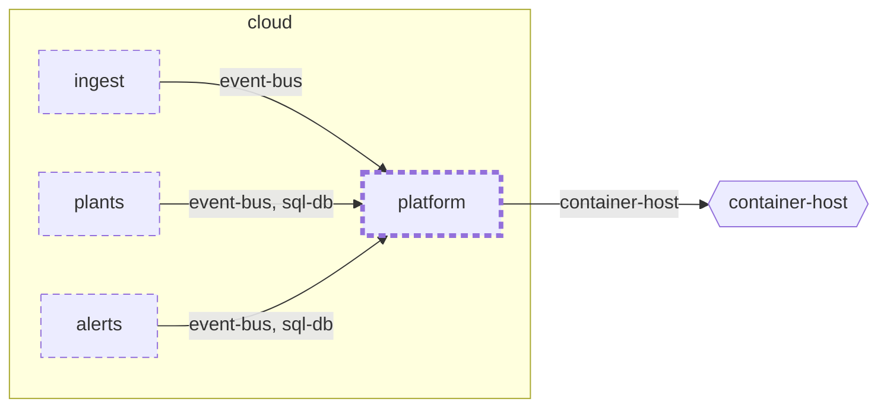

<!-- unifold:generated - do not edit; run `unifold generate` -->
# Context diagram: platform

[plantwatch](../../../../docs/diagrams/component.md) / [cloud](../../../docs/diagrams/component.md) / **platform** · [README](../../README.md)

`platform` inside `cloud`, with the units it is connected to. An arrow points from the unit that needs something to the unit that provides it. Rounded nodes are capabilities of the framing unit, hexagons are its needs. A dashed arrow is an alternative provider; a dashed border marks a unit that is planned.

| Unit | Kind | Summary | Status | Diagram |
|---|---|---|---|---|
| [platform](../../README.md) | infrastructure | Shared infrastructure of the services - message bus and database | **planned** | [context](context.md) |
| [alerts](../../../services/alerts/README.md) | service | Decides when a plant needs attention and notifies its owner once | **planned** | [component](../../../services/alerts/docs/diagrams/component.md) |
| [ingest](../../../services/ingest/README.md) | service | Accepts uploaded readings and announces each accepted one as an event | **planned** | [context](../../../services/ingest/docs/diagrams/context.md) |
| [plants](../../../services/plants/README.md) | service | Registry of plants with their sensors, thresholds and reading history | **planned** | [context](../../../services/plants/docs/diagrams/context.md) |

### Who provides what this unit needs

| Need | Kind | Own contract | Provided by | Capability | Their contract | Verified by |
|---|---|---|---|---|---|---|
| container-host | infrastructure |  | outside the project, as need `container-host` of the root (passed up by name) | | | |

### Who uses what this unit provides

| Capability | Kind | Contract | Verified by | Used by | As need | Their contract |
|---|---|---|---|---|---|---|
| event-bus | queue | [contract](../references/event-bus.md) |  | [cloud/services/ingest](../../../services/ingest/README.md) (planned) | event-bus |  |
| event-bus | queue | [contract](../references/event-bus.md) |  | [cloud/services/plants](../../../services/plants/README.md) (planned) | event-bus |  |
| event-bus | queue | [contract](../references/event-bus.md) |  | [cloud/services/alerts/server](../../../services/alerts/server/README.md) (planned) | event-bus |  |
| sql-db | db | [contract](../references/sql-db.md) |  | [cloud/services/plants](../../../services/plants/README.md) (planned) | sql-db |  |
| sql-db | db | [contract](../references/sql-db.md) |  | [cloud/services/alerts/server](../../../services/alerts/server/README.md) (planned) | sql-db |  |
