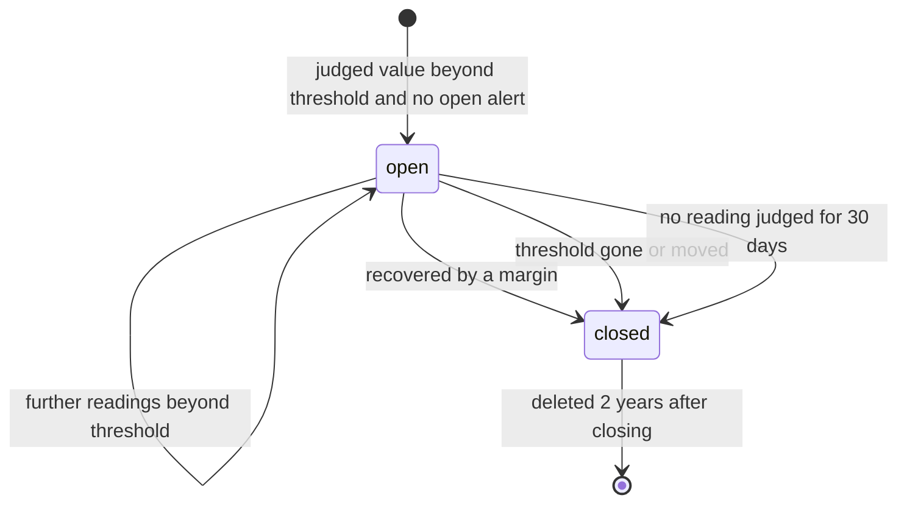
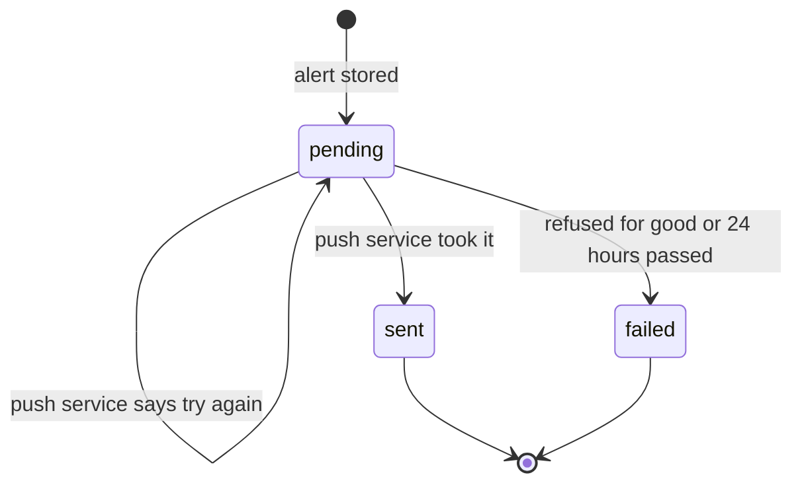
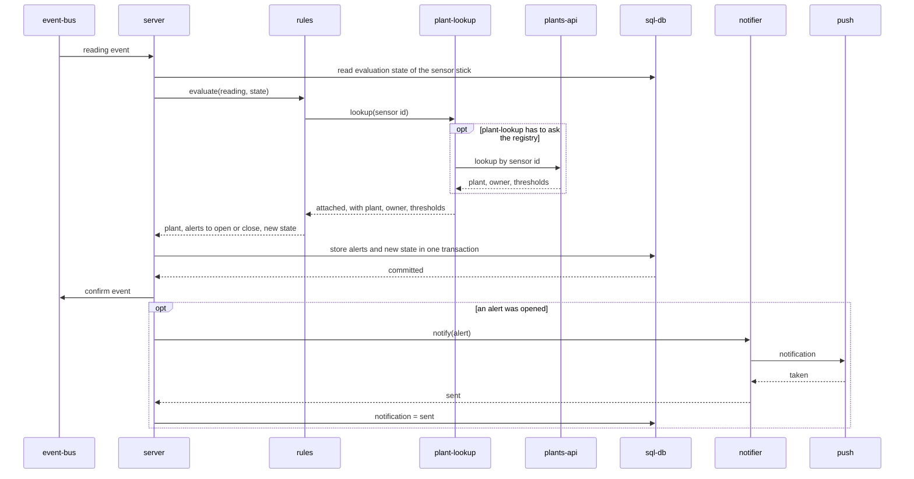

# Architecture of alerts

The long form of the why in [AGENTS.md](../AGENTS.md). Which children exist
and how they are wired is shown in the
[component diagram](diagrams/component.md).

## Reasoning

**Judging is pure.** Whether a reading opens or closes an alert depends on
the reading, the thresholds and what was judged before. It does not depend
on a database, a clock or a network. Kept as a library with no state of
its own, [rules](../rules/README.md) can be tested with tables of readings
and changed without touching storage.

**What lies behind a network gets an adapter.** The registry of plants and
the push service are reached over HTTP, can be slow and can fail. Each has
an adapter that offers a plain function and hides the rest:
[plant-lookup](../plant-lookup/README.md) for plant and thresholds,
[notifier](../notifier/README.md) for telling the owner, including the
wording. The side that calls an adapter states the function it expects in
a contract of its own need; the adapter is held to it
([0003](decisions/0003-thresholds-reach-the-judging-logic-through-an-adapter.md)).

**One process holds the state and the order.**
[server](../server/README.md) is the only child that stores anything
durably and the only one that knows in which order things happen. It
calls the judging and the notifying; nothing calls it back.

**Libraries, not services.** All parts are deployed as one program
([0001](decisions/0001-evaluation-and-notification-are-libraries-beside-one-process.md)).
An alert, the state that led to it and the fact that its notification is
still owed are then written in one database transaction
([0002](decisions/0002-the-alert-row-is-the-outbox-of-its-notification.md)).

## Invariants

- At most one alert is open per plant, quantity and bound.
- **One notification per opened alert.** Every alert is stored with a
  notification that is owed. The notification is handed to the push
  service at least once and, seen by the owner, once.
- No notification without a stored alert. An alert is committed before
  anything is sent.
- A reading is judged at most once per sensor stick, and never after a
  newer reading of the same sensor stick was judged.
- A closed alert stays closed.
- Judging uses the time of readings only. Handling the same events in the
  same order gives the same alerts.

How the children share the work for the notification invariant:

| Danger | What prevents it |
|---|---|
| An event arrives twice and the alert opens twice | The evaluation state says the alert is open; the stored alerts allow one open alert per plant, quantity and bound |
| The process stops after storing the alert and before notifying | The alert is stored as owing a notification; delivery starts again from the stored alerts |
| The process stops after the push service took the notification and before that is stored | The alert is notified again; [notifier](../notifier/README.md) makes a repeat for the same alert harmless |
| The push service is down | The notification stays owed and is tried again for 24 hours |

## The life of an alert

An alert has two things that change: its state and the state of its
notification. They are independent; an alert can close while its
notification is still owed. The notification is sent all the same.

The first diagram is the state of the alert, the second the state of its
notification. The three ways to close set `closed_reason` to `recovered`,
`threshold_changed` and `expired`.

| Transition | Decided by | Stored by |
|---|---|---|
| open, closed with `recovered` or `threshold_changed` | [rules](../rules/README.md), when a reading is judged | [server](../server/README.md) |
| closed with `expired` | [server](../server/README.md), by time | [server](../server/README.md) |
| `pending` to `sent` or `failed` | the answer of [notifier](../notifier/README.md), or 24 hours | [server](../server/README.md) |

## Handling one reading

The sequence shows the direct children of `alerts` and its needs.

The last block, notifying, is not tied to the event. It runs for every
stored alert whose notification is pending, also after a restart.

## Trade-offs

- A lookup of thresholds stands between an event and its alert. While the
  lookup answers `unavailable`, events of that sensor stick wait. The
  alternative, a copy of all thresholds inside `alerts`, is rejected one
  level up ([context](context.md)).
- A threshold that was changed takes up to 60 seconds to apply, because
  an answer of the registry may be reused that long.
- The interface between a caller and its adapter is written down twice:
  as the contract of the need and as the contract of the port. Whoever
  changes one side reads the other.
- Notifications are effectively once, not exactly once. A repeat that
  reaches a phone after the owner has dismissed the first one is shown
  again. The window for this is the few seconds between sending and
  storing.
- Alerts of a plant that was deleted or lost its sensor stick stay open
  until they expire, because `alerts` is not told about such changes.
