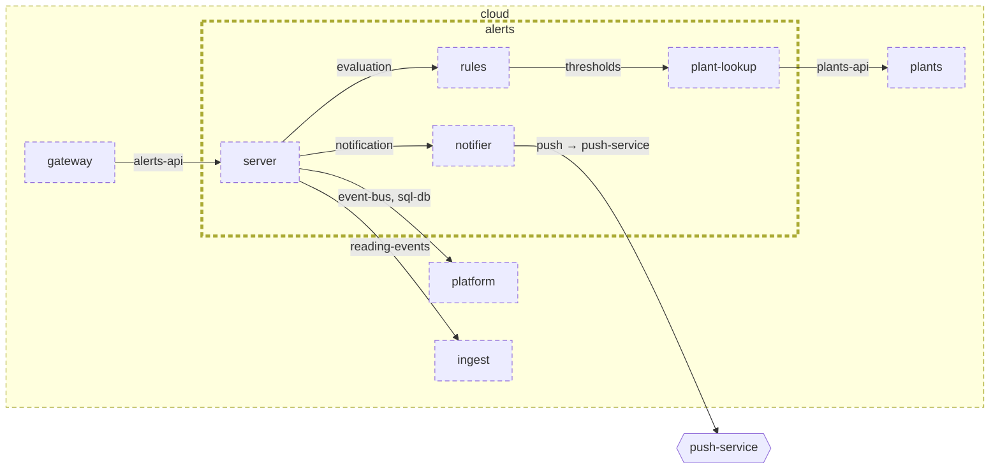

<!-- youmedoc:generated - do not edit; run `youmedoc generate` -->
# Architecture diagram: alerts

[plantwatch](../../../../../doc/diagrams/component.md) / [cloud](../../../../doc/diagrams/component.md) / **alerts** · [README](../../README.md) · [context](context.md) · [component](component.md)

`alerts` next to its siblings in `cloud`, opened up 3 level(s) down. Arrows point from the side that needs something to the side that provides it. Rounded nodes are ports the framing unit provides, hexagons are its needs. A dashed arrow is an alternative provider; a dashed border marks a planned unit.

| Unit | Kind | Diagram |
|---|---|---|
| [cloud](../../../../README.md) | system | [component](../../../../doc/diagrams/component.md) |
| [platform](../../../../platform/README.md) | infrastructure | [context](../../../../platform/doc/diagrams/context.md) |
| [alerts](../../README.md) | service | [component](component.md) |
| [notifier](../../notifier/README.md) | adapter | [context](../../notifier/doc/diagrams/context.md) |
| [plant-lookup](../../plant-lookup/README.md) | adapter | [context](../../plant-lookup/doc/diagrams/context.md) |
| [rules](../../rules/README.md) | library | [context](../../rules/doc/diagrams/context.md) |
| [server](../../server/README.md) | app | [context](../../server/doc/diagrams/context.md) |
| [gateway](../../../gateway/README.md) | service | [context](../../../gateway/doc/diagrams/context.md) |
| [ingest](../../../ingest/README.md) | service | [context](../../../ingest/doc/diagrams/context.md) |
| [plants](../../../plants/README.md) | service | [context](../../../plants/doc/diagrams/context.md) |
