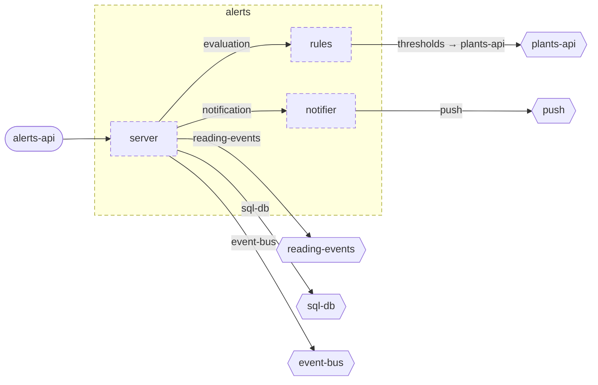

<!-- youmedoc:generated - do not edit; run `youmedoc generate` -->
# Component diagram: alerts

[alerts](../../README.md) · [context](context.md) · [architecture](architecture.md)

The units directly inside `alerts` and how they are wired. Arrows point from the side that needs something to the side that provides it. Rounded nodes are ports the framing unit provides, hexagons are its needs. Dashed arrows are alternative providers; dashed borders mark planned units.

| Unit | Summary | Status | Diagram |
|---|---|---|---|
| [alerts](../../README.md) | Decides when a plant needs attention and notifies its owner once | planned | [component](component.md) |
| [notifier](../../notifier/README.md) | Turns an opened alert into one notification to the owner | planned | [context](../../notifier/doc/diagrams/context.md) |
| [rules](../../rules/README.md) | Evaluates readings against the thresholds of a plant | planned | [context](../../rules/doc/diagrams/context.md) |
| [server](../../server/README.md) | Process of the alerts service - consumes readings, stores alerts and answers queries | planned | [context](../../server/doc/diagrams/context.md) |
