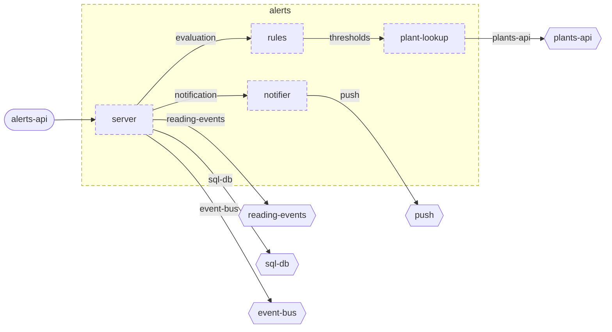

<!-- youmedoc:generated - do not edit; run `youmedoc generate` -->
# Component diagram: alerts

[plantwatch](../../../../../doc/diagrams/component.md) / [cloud](../../../../doc/diagrams/component.md) / **alerts** · [README](../../README.md) · [context](context.md) · [architecture](architecture.md)

The units directly inside `alerts` and how they are wired. Arrows point from the side that needs something to the side that provides it. Rounded nodes are ports the framing unit provides, hexagons are its needs. A dashed arrow is an alternative provider; a dashed border marks a planned unit.

| Unit | Kind | Summary | Status | Diagram |
|---|---|---|---|---|
| [alerts](../../README.md) | service | Decides when a plant needs attention and notifies its owner once | planned | [component](component.md) |
| [notifier](../../notifier/README.md) | adapter | Turns an opened alert into one notification to the owner | planned | [context](../../notifier/doc/diagrams/context.md) |
| [plant-lookup](../../plant-lookup/README.md) | adapter | Looks up the plant a sensor stick is attached to, with owner and thresholds, in the registry of plants | planned | [context](../../plant-lookup/doc/diagrams/context.md) |
| [rules](../../rules/README.md) | library | Evaluates readings against the thresholds of a plant | planned | [context](../../rules/doc/diagrams/context.md) |
| [server](../../server/README.md) | app | Process that consumes readings, stores the alerts they lead to and answers queries about them | planned | [context](../../server/doc/diagrams/context.md) |
