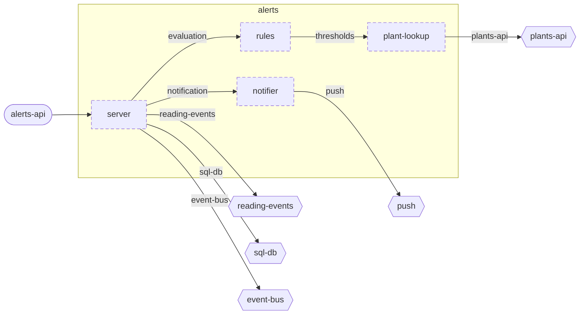

<!-- unifold:generated - do not edit; run `unifold generate` -->
# Component diagram: alerts

[plantwatch](../../../../../docs/diagrams/component.md) / [cloud](../../../../docs/diagrams/component.md) / **alerts** · [README](../../README.md) · [context](context.md)

The units directly inside `alerts` and how they are connected. An arrow points from the unit that needs something to the unit that provides it. Rounded nodes are capabilities of the framing unit, hexagons are its needs. A dashed arrow is an alternative provider; a dashed border marks a unit that is planned.

| Unit | Kind | Summary | Status | Diagram |
|---|---|---|---|---|
| [notifier](../../notifier/README.md) | adapter | Turns an opened alert into one notification to the owner | **planned** | [context](../../notifier/docs/diagrams/context.md) |
| [plant-lookup](../../plant-lookup/README.md) | adapter | Looks up the plant a sensor stick is attached to, with owner and thresholds, in the registry of plants | **planned** | [context](../../plant-lookup/docs/diagrams/context.md) |
| [rules](../../rules/README.md) | library | Evaluates readings against the thresholds of a plant | **planned** | [context](../../rules/docs/diagrams/context.md) |
| [server](../../server/README.md) | app | Process that consumes readings, stores the alerts they lead to and answers queries about them | **planned** | [context](../../server/docs/diagrams/context.md) |

### Connections

| Need | Provider | Note |
|---|---|---|
| capability `alerts-api` of `alerts` | `server.alerts-api` | implemented by |
| `server.evaluation` | `rules.evaluation` |  |
| `server.notification` | `notifier.notification` |  |
| `rules.thresholds` | `plant-lookup.thresholds` |  |
| `notifier.push` | need `push` of `alerts` | passed up by name |
| `plant-lookup.plants-api` | need `plants-api` of `alerts` | passed up by name |
| `server.reading-events` | need `reading-events` of `alerts` | passed up by name |
| `server.sql-db` | need `sql-db` of `alerts` | passed up by name |
| `server.event-bus` | need `event-bus` of `alerts` | passed up by name |
