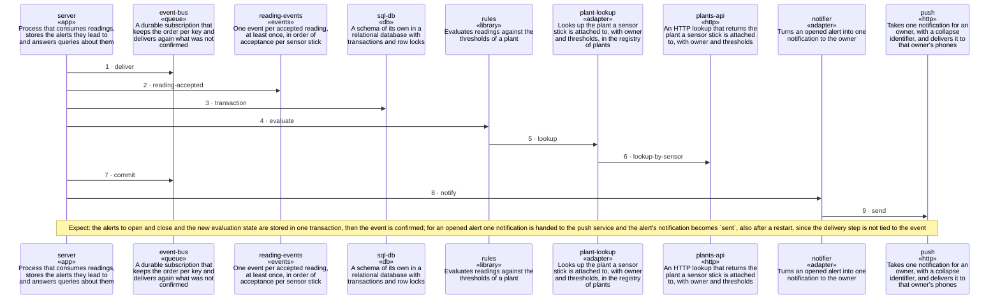

<!-- unifold:generated - do not edit; run `unifold generate` -->
# Scenario: handle-a-reading

[plantwatch](../../../../../docs/diagrams/component.md) / [cloud](../../../../docs/diagrams/component.md) / **alerts** · [README](../../README.md) · [context](context.md) · [component](component.md)

**One reading event is judged, the alerts it causes are stored, and an opened alert is notified**
Source: decisions 0001 and 0002 of alerts
Expect: the alerts to open and close and the new evaluation state are stored in one transaction, then the event is confirmed; for an opened alert one notification is handed to the push service and the alert's notification becomes `sent`, also after a restart, since the delivery step is not tied to the event

A unit is named by its path from `alerts`; a capability or need of `alerts` is named bare. Every hop is a call along one connection of the map.

| # | Caller | Target | Part | Contract |
|---|---|---|---|---|
| 1 | `server` | `event-bus` | `deliver` | [event-bus](../../../../docs/references/event-bus.md) |
| 2 | `server` | `reading-events` | `reading-accepted` | [reading-events](../../../../docs/references/reading-events.md) |
| 3 | `server` | `sql-db` | `transaction` | [sql-db](../../../../docs/references/sql-db.md) |
| 4 | `server` | `rules` | `evaluate` | [evaluation](../references/evaluation.md) |
| 5 | `rules` | `plant-lookup` | `lookup` | [thresholds](../references/thresholds.md) |
| 6 | `plant-lookup` | `plants-api` | `lookup-by-sensor` | [plants-api](../../../../docs/references/plants-api.md) |
| 7 | `server` | `event-bus` | `commit` | [event-bus](../../../../docs/references/event-bus.md) |
| 8 | `server` | `notifier` | `notify` | [notification](../references/notification.md) |
| 9 | `notifier` | `push` | `send` | [push-service](../../../../../docs/references/push-service.md) |
