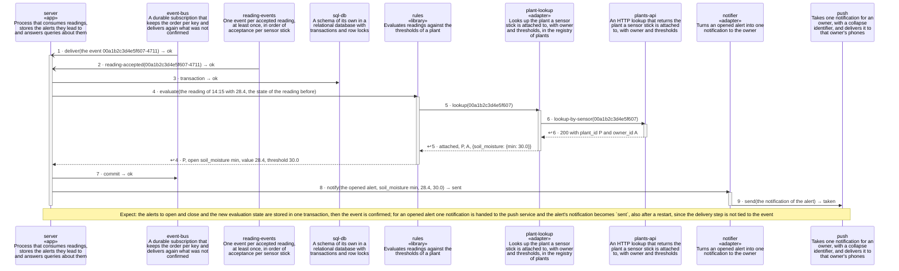

<!-- unifold:generated - do not edit; run `unifold check --fix` -->
# Scenario: handle-a-reading

[plantwatch](../../../../../docs/diagrams/component.md) / [cloud](../../../../docs/diagrams/component.md) / **alerts** · [README](../../README.md) · [context](context.md) · [component](component.md)

**One reading event is judged, the alerts it causes are stored, and an opened alert is notified**
Source: decisions 0001 and 0002 of alerts
Expect: the alerts to open and close and the new evaluation state are stored in one transaction, then the event is confirmed; for an opened alert one notification is handed to the push service and the alert's notification becomes `sent`, also after a restart, since the delivery step is not tied to the event

A unit is named by its path from `alerts`; a capability or need of `alerts` is named bare. Every step is one hop along one connection of the map, drawn as the kind of its part says: a command or query goes from the caller to the target, and a dashed arrow brings the result of a query back; an event goes from the provider that raises it to the caller that receives it, with an open arrowhead. A bar is the time a lifeline is busy with a step; it ends when a lifeline further out makes the next step, and a unit below the busy one acts for it. An event from an idle lifeline lands on the bar of a busy receiver, or starts one. A step shows its result; a note on a provider's lifeline shows the state of a connection whose contract has states.

| # | Caller | Target | Call | Kind | Result | State | Contract |
|---|---|---|---|---|---|---|---|
| 1 | `server` | `event-bus` | `deliver(the event 00a1b2c3d4e5f607-4711)` | event | ok |  | [event-bus](../../../../docs/references/event-bus.md) |
| 2 | `server` | `reading-events` | `reading-accepted(00a1b2c3d4e5f607-4711)` | event | ok |  | [reading-events](../../../../docs/references/reading-events.md) |
| 3 | `server` | `sql-db` | `transaction` | command | ok |  | [sql-db](../../../../docs/references/sql-db.md) |
| 4 | `server` | `rules` | `evaluate(the reading of 14:15 with 28.4, the state of the reading before)` | query | P, open soil_moisture min, value 28.4, threshold 30.0 |  | [evaluation](../references/evaluation.md) |
| 5 | `rules` | `plant-lookup` | `lookup(00a1b2c3d4e5f607)` | query | attached, P, A, {soil_moisture: {min: 30.0}} |  | [thresholds](../references/thresholds.md) |
| 6 | `plant-lookup` | `plants-api` | `lookup-by-sensor(00a1b2c3d4e5f607)` | query | 200 with plant_id P and owner_id A |  | [plants-api](../../../../docs/references/plants-api.md) |
| 7 | `server` | `event-bus` | `commit` | command | ok |  | [event-bus](../../../../docs/references/event-bus.md) |
| 8 | `server` | `notifier` | `notify(the opened alert, soil_moisture min, 28.4, 30.0)` | command | sent |  | [notification](../references/notification.md) |
| 9 | `notifier` | `push` | `send(the notification of the alert)` | command | taken |  | [push-service](../../../../../docs/references/push-service.md) |
