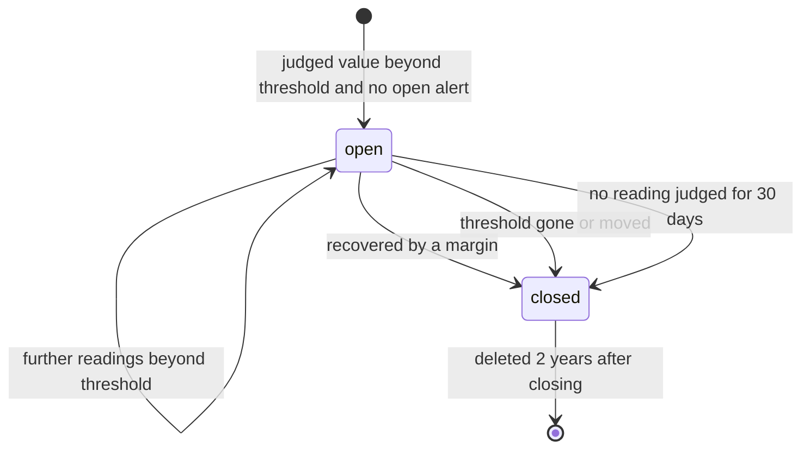
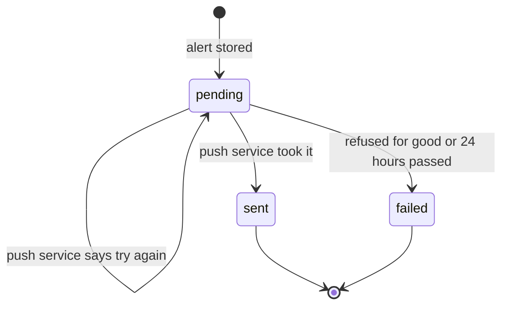
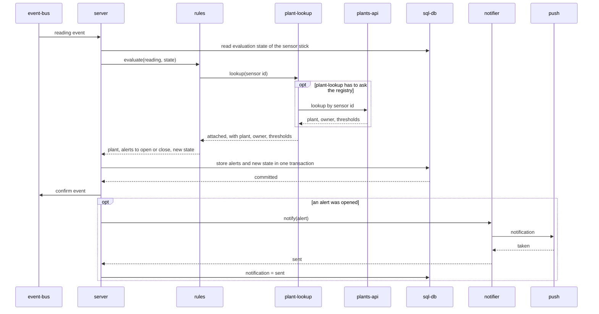

# Runtime of alerts

Scenarios that cross the children of this unit and that no single child
can tell. Which children exist is in the
[component diagram](../diagrams/component.md).

## The life of an alert

An alert has two things that change: its state and the state of its
notification. They are independent; an alert can close while its
notification is still owed. The notification is sent all the same.

The first diagram is the state of the alert, the second the state of its
notification. The three ways to close set `closed_reason` to `recovered`,
`threshold_changed` and `expired`.

| Transition | Decided by | Stored by |
|---|---|---|
| open, closed with `recovered` or `threshold_changed` | [rules](../../rules/README.md), when a reading is judged | [server](../../server/README.md) |
| closed with `expired` | [server](../../server/README.md), by time | [server](../../server/README.md) |
| `pending` to `sent` or `failed` | the answer of [notifier](../../notifier/README.md), or 24 hours | [server](../../server/README.md) |

## Handling one reading

The sequence shows the direct children of `alerts` and its needs.

The last block, notifying, is not tied to the event. It runs for every
stored alert whose notification is pending, also after a restart.
