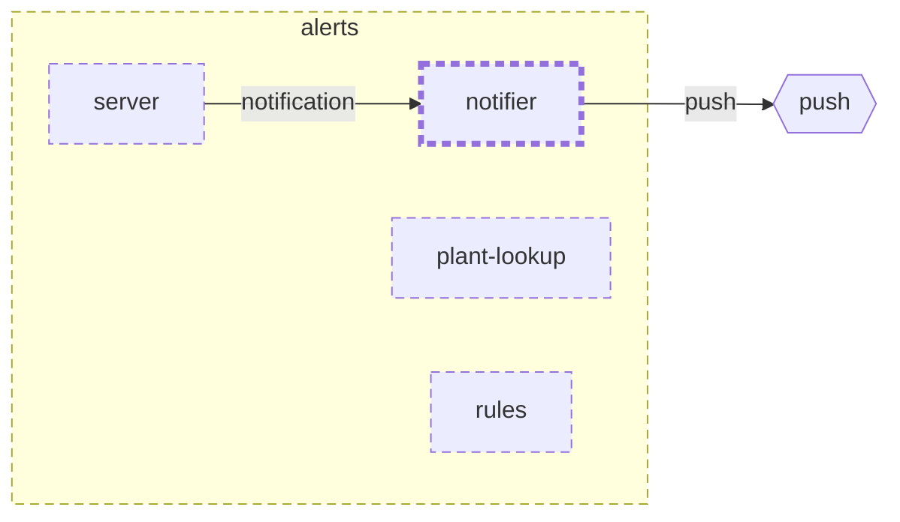

<!-- youmedoc:generated - do not edit; run `youmedoc generate` -->
# Context diagram: notifier

[plantwatch](../../../../../../doc/diagrams/component.md) / [cloud](../../../../../doc/diagrams/component.md) / [alerts](../../../doc/diagrams/component.md) / **notifier** · [README](../../README.md)

`notifier` among its siblings inside `alerts`. Only connections that touch `notifier` are drawn. Arrows point from the side that needs something to the side that provides it. Rounded nodes are ports the framing unit provides, hexagons are its needs. A dashed arrow is an alternative provider; a dashed border marks a planned unit.

| Unit | Kind | Diagram |
|---|---|---|
| [alerts](../../../README.md) | service | [component](../../../doc/diagrams/component.md) |
| [notifier](../../README.md) | adapter | [context](context.md) |
| [plant-lookup](../../../plant-lookup/README.md) | adapter | [context](../../../plant-lookup/doc/diagrams/context.md) |
| [rules](../../../rules/README.md) | library | [context](../../../rules/doc/diagrams/context.md) |
| [server](../../../server/README.md) | app | [context](../../../server/doc/diagrams/context.md) |

### Who provides what this unit needs

| Need | Kind | Own contract | Provided by | Port | Their contract |
|---|---|---|---|---|---|
| push | http |  | outside the project, as need `push-service` of the root | | |

### Who uses what this unit provides

| Port | Kind | Used by | As need | Their contract |
|---|---|---|---|---|
| notification | library | [cloud/services/alerts/server](../../../server/README.md) | notification | [contract](../../../server/doc/references/notification.md) |
