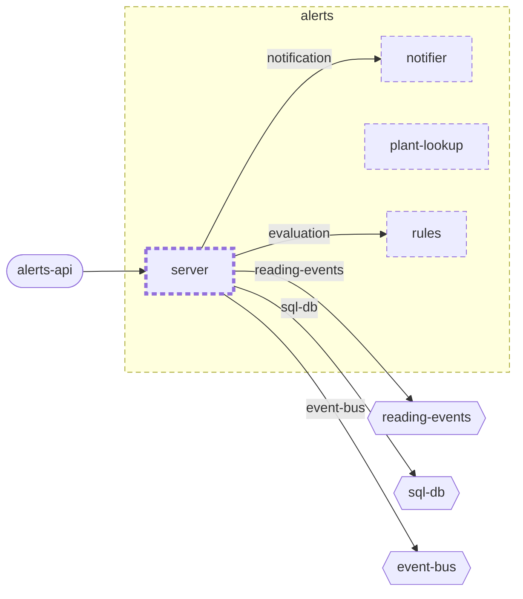

<!-- unifold:generated - do not edit; run `unifold generate` -->
# Context diagram: server

[plantwatch](../../../../../../doc/diagrams/component.md) / [cloud](../../../../../doc/diagrams/component.md) / [alerts](../../../doc/diagrams/component.md) / **server** · [README](../../README.md)

`server` among its siblings inside `alerts`. Only connections that touch `server` are drawn. Arrows point from the side that needs something to the side that provides it. Rounded nodes are ports the framing unit provides, hexagons are its needs. A dashed arrow is an alternative provider; a dashed border marks a planned unit.

| Unit | Kind | Diagram |
|---|---|---|
| [alerts](../../../README.md) | service | [component](../../../doc/diagrams/component.md) |
| [notifier](../../../notifier/README.md) | adapter | [context](../../../notifier/doc/diagrams/context.md) |
| [plant-lookup](../../../plant-lookup/README.md) | adapter | [context](../../../plant-lookup/doc/diagrams/context.md) |
| [rules](../../../rules/README.md) | library | [context](../../../rules/doc/diagrams/context.md) |
| [server](../../README.md) | app | [context](context.md) |

### Who provides what this unit needs

| Need | Kind | Own contract | Provided by | Port | Their contract |
|---|---|---|---|---|---|
| reading-events | events | [contract](../references/reading-events.md) | [cloud/services/ingest](../../../../ingest/README.md) | reading-events | [contract](../../../../ingest/doc/references/reading-events.md) |
| evaluation | library | [contract](../references/evaluation.md) | [cloud/services/alerts/rules](../../../rules/README.md) | evaluation | [contract](../../../rules/doc/references/evaluation.md) |
| notification | library | [contract](../references/notification.md) | [cloud/services/alerts/notifier](../../../notifier/README.md) | notification | [contract](../../../notifier/doc/references/notification.md) |
| sql-db | db |  | [cloud/platform](../../../../../platform/README.md) | sql-db | [contract](../../../../../platform/doc/references/sql-db.md) |
| event-bus | queue |  | [cloud/platform](../../../../../platform/README.md) | event-bus | [contract](../../../../../platform/doc/references/event-bus.md) |

### Who uses what this unit provides

| Port | Kind | Used by | As need | Their contract |
|---|---|---|---|---|
| alerts-api | http | [cloud/services/gateway](../../../../gateway/README.md) | alerts-api |  |
