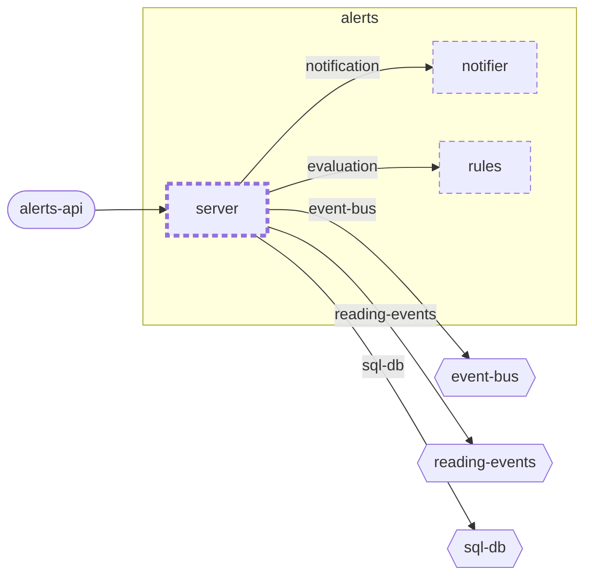

<!-- unifold:generated - do not edit; run `unifold generate` -->
# Context diagram: server

[plantwatch](../../../../../../docs/diagrams/component.md) / [cloud](../../../../../docs/diagrams/component.md) / [alerts](../../../docs/diagrams/component.md) / **server** · [README](../../README.md)

`server` inside `alerts`, with the units it is connected to. An arrow points from the unit that needs something to the unit that provides it. Rounded nodes are capabilities of the framing unit, hexagons are its needs. A dashed arrow is an alternative provider; a dashed border marks a unit that is planned.

| Unit | Kind | Summary | Status | Diagram |
|---|---|---|---|---|
| [notifier](../../../notifier/README.md) | adapter | Turns an opened alert into one notification to the owner | **planned** | [context](../../../notifier/docs/diagrams/context.md) |
| [rules](../../../rules/README.md) | library | Evaluates readings against the thresholds of a plant | **planned** | [context](../../../rules/docs/diagrams/context.md) |
| [server](../../README.md) | app | Process that consumes readings, stores the alerts they lead to and answers queries about them | **planned** | [context](context.md) |

### Who provides what this unit needs

| Need | Kind | Contract | Provided by | Capability | Verified by |
|---|---|---|---|---|---|
| reading-events | events | [contract](../../../../../docs/references/reading-events.md) | [cloud/services/ingest](../../../../ingest/README.md) (planned) | reading-events |  |
| evaluation | library | [contract](../../../docs/references/evaluation.md) | [cloud/services/alerts/rules](../../../rules/README.md) (planned) | evaluation |  |
| notification | library | [contract](../../../docs/references/notification.md) | [cloud/services/alerts/notifier](../../../notifier/README.md) (planned) | notification |  |
| sql-db | db | [contract](../../../../../docs/references/sql-db.md) | [cloud/platform](../../../../../platform/README.md) (planned) | sql-db |  |
| event-bus | queue | [contract](../../../../../docs/references/event-bus.md) | [cloud/platform](../../../../../platform/README.md) (planned) | event-bus |  |

### Who uses what this unit provides

| Capability | Kind | Contract | Verified by | Used by | As need |
|---|---|---|---|---|---|
| alerts-api | http | [contract](../../../../../docs/references/alerts-api.md) |  | [cloud/services/gateway](../../../../gateway/README.md) (planned) | alerts-api |
