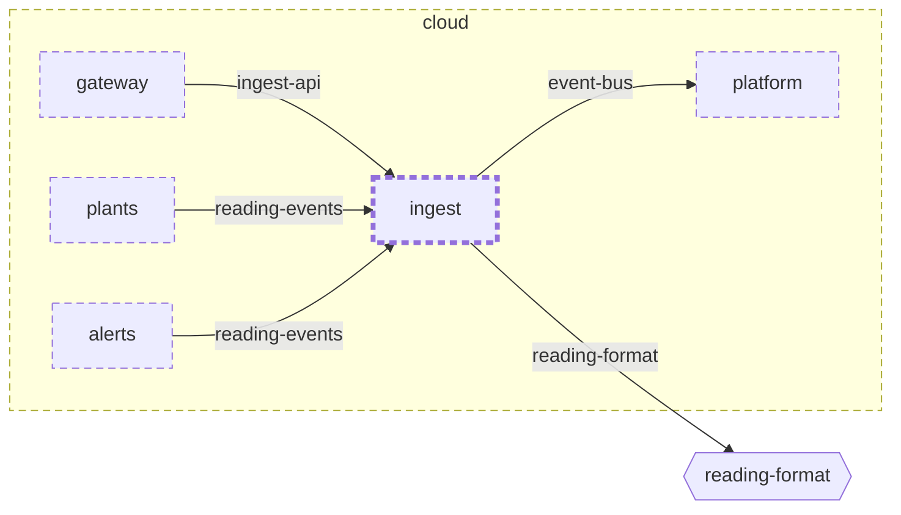

<!-- youmedoc:generated - do not edit; run `youmedoc generate` -->
# Context diagram: ingest

[plantwatch](../../../../../doc/diagrams/component.md) / [cloud](../../../../doc/diagrams/component.md) / **ingest** · [README](../../README.md)

`ingest` among its siblings inside `cloud`. Only connections that touch `ingest` are drawn. Arrows point from the side that needs something to the side that provides it. Rounded nodes are ports the framing unit provides, hexagons are its needs. A dashed arrow is an alternative provider; a dashed border marks a planned unit.

| Unit | Kind | Diagram |
|---|---|---|
| [cloud](../../../../README.md) | system | [component](../../../../doc/diagrams/component.md) |
| [platform](../../../../platform/README.md) | infrastructure | [context](../../../../platform/doc/diagrams/context.md) |
| [alerts](../../../alerts/README.md) | service | [component](../../../alerts/doc/diagrams/component.md) |
| [gateway](../../../gateway/README.md) | service | [context](../../../gateway/doc/diagrams/context.md) |
| [ingest](../../README.md) | service | [context](context.md) |
| [plants](../../../plants/README.md) | service | [context](../../../plants/doc/diagrams/context.md) |

### Who provides what this unit needs

| Need | Kind | Own contract | Provided by | Port | Their contract |
|---|---|---|---|---|---|
| event-bus | queue |  | [cloud/platform](../../../../platform/README.md) | event-bus | [contract](../../../../platform/doc/references/event-bus.md) |
| reading-format | specification |  | [protocol](../../../../../protocol/README.md) | reading-schema | [contract](../../../../../protocol/doc/references/reading-schema.md) |

### Who uses what this unit provides

| Port | Kind | Used by | As need | Their contract |
|---|---|---|---|---|
| ingest-api | http | [cloud/services/gateway](../../../gateway/README.md) | ingest-api |  |
| reading-events | events | [cloud/services/plants](../../../plants/README.md) | reading-events | [contract](../../../plants/doc/references/reading-events.md) |
| reading-events | events | [cloud/services/alerts/server](../../../alerts/server/README.md) | reading-events | [contract](../../../alerts/server/doc/references/reading-events.md) |
