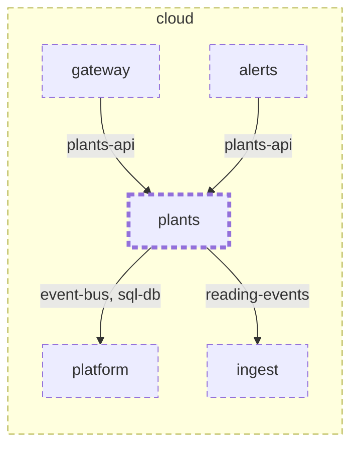

<!-- youmedoc:generated - do not edit; run `youmedoc generate` -->
# Context diagram: plants

[plantwatch](../../../../../doc/diagrams/component.md) / [cloud](../../../../doc/diagrams/component.md) / **plants** · [README](../../README.md)

`plants` among its siblings inside `cloud`. Only connections that touch `plants` are drawn. Arrows point from the side that needs something to the side that provides it. Rounded nodes are ports the framing unit provides, hexagons are its needs. A dashed arrow is an alternative provider; a dashed border marks a planned unit.

| Unit | Kind | Diagram |
|---|---|---|
| [cloud](../../../../README.md) | system | [component](../../../../doc/diagrams/component.md) |
| [platform](../../../../platform/README.md) | infrastructure | [context](../../../../platform/doc/diagrams/context.md) |
| [alerts](../../../alerts/README.md) | service | [component](../../../alerts/doc/diagrams/component.md) |
| [gateway](../../../gateway/README.md) | service | [context](../../../gateway/doc/diagrams/context.md) |
| [ingest](../../../ingest/README.md) | service | [context](../../../ingest/doc/diagrams/context.md) |
| [plants](../../README.md) | service | [context](context.md) |

### Who provides what this unit needs

| Need | Kind | Own contract | Provided by | Port | Their contract |
|---|---|---|---|---|---|
| reading-events | events | [contract](../references/reading-events.md) | [cloud/services/ingest](../../../ingest/README.md) | reading-events | [contract](../../../ingest/doc/references/reading-events.md) |
| sql-db | db |  | [cloud/platform](../../../../platform/README.md) | sql-db | [contract](../../../../platform/doc/references/sql-db.md) |
| event-bus | queue |  | [cloud/platform](../../../../platform/README.md) | event-bus | [contract](../../../../platform/doc/references/event-bus.md) |

### Who uses what this unit provides

| Port | Kind | Used by | As need | Their contract |
|---|---|---|---|---|
| plants-api | http | [cloud/services/gateway](../../../gateway/README.md) | plants-api |  |
| plants-api | http | [cloud/services/alerts/plant-lookup](../../../alerts/plant-lookup/README.md) | plants-api |  |
