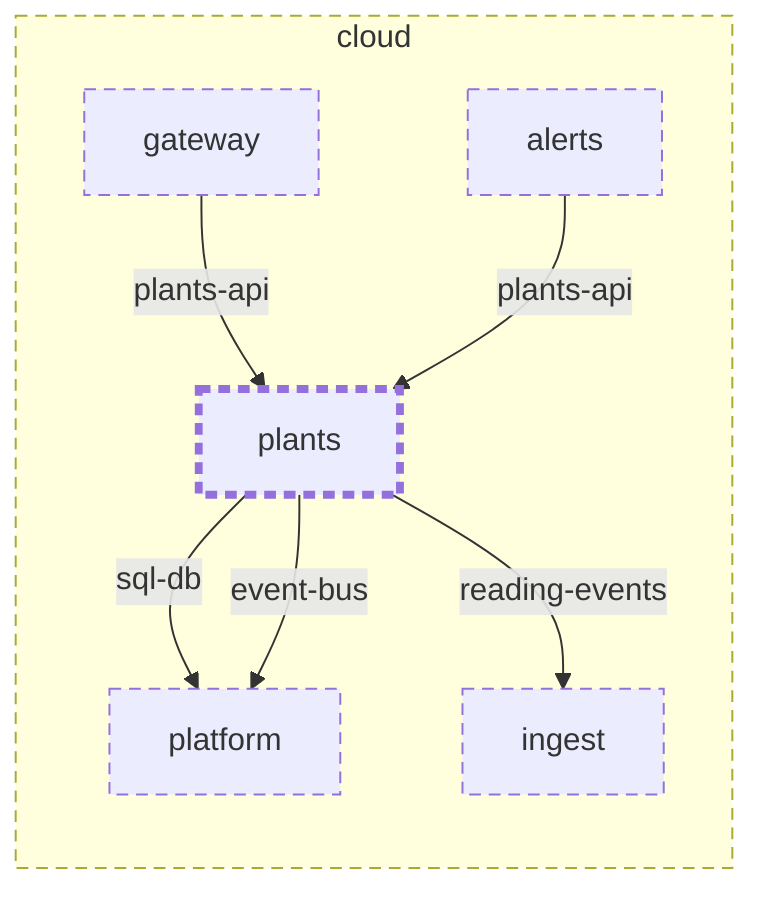

<!-- youmedoc:generated - do not edit; run `youmedoc generate` -->
# Context diagram: plants

[plants](../../README.md)

`plants` among its siblings inside `cloud`. Only connections that touch `plants` are drawn. Arrows point from the side that needs something to the side that provides it. Rounded nodes are ports the framing unit provides, hexagons are its needs. Dashed arrows are alternative providers; dashed borders mark planned units.

| Unit | Summary | Status | Diagram |
|---|---|---|---|
| [cloud](../../../../README.md) | Server side that stores readings, keeps the plant registry and raises alerts | planned | [component](../../../../doc/diagrams/component.md) |
| [platform](../../../../platform/README.md) | Shared infrastructure of the services - message bus and database | planned | [context](../../../../platform/doc/diagrams/context.md) |
| [alerts](../../../alerts/README.md) | Decides when a plant needs attention and notifies its owner once | planned | [component](../../../alerts/doc/diagrams/component.md) |
| [gateway](../../../gateway/README.md) | Single entry point of the server side that authenticates callers and routes requests | planned | [context](../../../gateway/doc/diagrams/context.md) |
| [ingest](../../../ingest/README.md) | Accepts uploaded readings, validates them and publishes each one once | planned | [context](../../../ingest/doc/diagrams/context.md) |
| [plants](../../README.md) | Registry of plants with their sensors, thresholds and reading history | planned | [context](context.md) |
