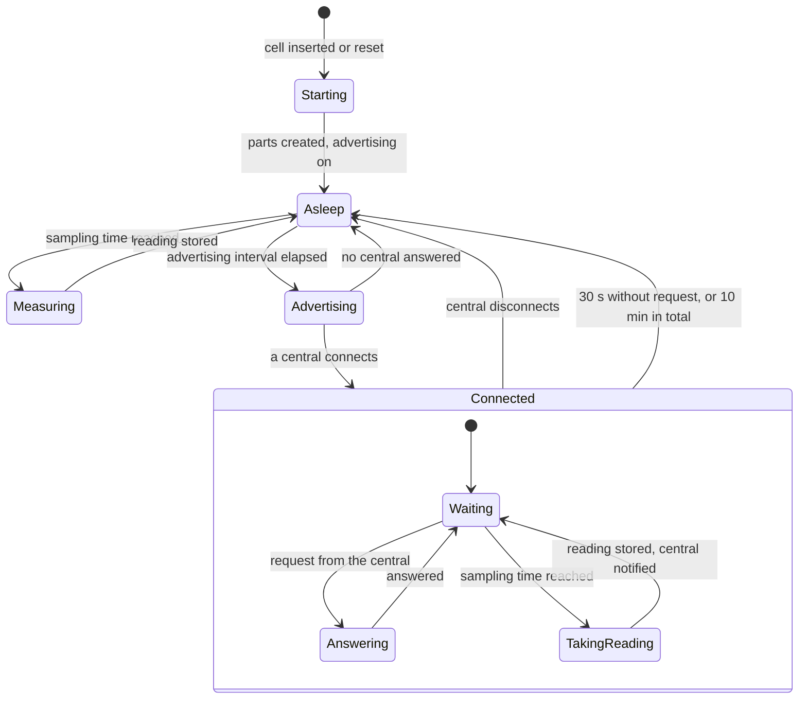

# Architecture of device

The long form of the why in [AGENTS.md](../AGENTS.md). Which parts exist
and how they are wired is shown in the
[component diagram](diagrams/component.md).

## Reasoning

**Energy decides the control flow.** The
[energy budget](references/energy-budget.md) allows 19.4 µA on average,
and a running processor draws 200 times that. The firmware is therefore a
set of reactions to two sources of events, a timer and the radio. Between
events the board sleeps
([0001](decisions/0001-sleep-between-events-and-advertise-all-the-time.md)).

**The hardware has one owner.** Everything that depends on the board is
in [hal](../hal/README.md). The reason is less portability than testing:
the rest of the firmware is logic about readings, memory and a profile,
and it is tested on a development machine against substitutes
([0002](decisions/0002-only-one-part-touches-the-hardware.md)).

**The other boundaries follow the reasons for change.** Measuring and
calibration change with the sensors, so they are in
[sampling](../sampling/README.md). The way readings survive in memory
changes with the memory technology, so it is in
[store](../store/README.md). Everything that knows the BLE profile
changes with the profile, so it is in [link](../link/README.md). None of
the three knows how the others work, and each has one job that can be
stated in a sentence.

**A reading gets its identity where it is made.** If the part that keeps
readings numbered them, a reading would have no number until it is stored,
and a reading shown live could not be recognised when it is fetched later.
The number is therefore computed from the tick count at the moment of
measuring
([0003](decisions/0003-sequence-numbers-are-derived-from-the-tick-count.md)).

**There is no main program.** The start-up code creates the parts and
returns; after that only events run. This keeps the order of things in
one place, the list under "Start" below, and out of the parts.

## Invariants

- No file outside the folder of [hal](../hal/README.md) includes a vendor
  header or touches a register.
- A reading is complete, numbered and unchangeable when it leaves the part
  that made it.
- A reading is in durable memory before the board sleeps after taking it.
- A stored reading is released only by a confirm of a central or by an
  overflow of the memory. No part releases one on its own judgement.
- Sampling is never late by more than 1 s because of the radio. A
  connected central does not stop the firmware from taking readings.
- No part keeps a wall-clock time. The only time is the tick count.
- The average current stays within the
  [energy budget](references/energy-budget.md).

## Start

The start-up code creates the parts in this order, because each step
relies on the one before:

1. The hardware layer. The boot counter rises here.
2. The memory for readings. It recovers its state.
3. Measuring. The first reading is due within 10 s.
4. The BLE profile. It starts advertising last, so that a central
   never meets a sensor stick that cannot answer.

## Behaviour over time

The board is asleep unless one of three things happens. The diagram shows
the states of the whole firmware, not of a single part.

| State | Typical duration | How often |
|---|---|---|
| Measuring | 260 ms, of which the processor runs about 10 ms | Every sampling interval |
| Advertising | 3 ms | Every 1285 ms while not connected |
| Connected | 3 to 5 s | About 4 times a day |
| Asleep | The rest: more than 99 % of the time | |

In the state Connected the board also sleeps between connection events.
"Waiting" means that the connection is held, not that the processor runs.

## Trade-offs

| Chosen | Given up | Decision |
|---|---|---|
| Being found at any time | Half of the energy budget goes into advertising | [0001](decisions/0001-sleep-between-events-and-advertise-all-the-time.md) |
| Testing on a development machine | One layer of calls between logic and hardware | [0002](decisions/0002-only-one-part-touches-the-hardware.md) |
| Identity without stored state | Consecutive sequence numbers; an upper limit of starts | [0003](decisions/0003-sequence-numbers-are-derived-from-the-tick-count.md) |
