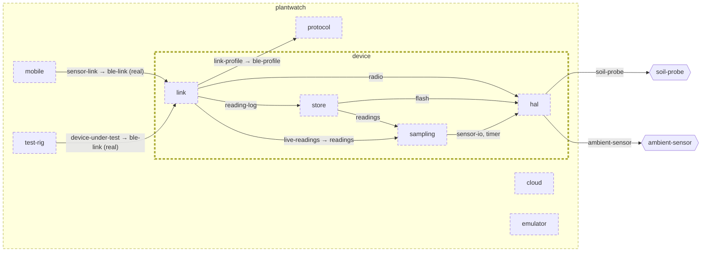

<!-- unifold:generated - do not edit; run `unifold generate` -->
# Architecture diagram: device

[plantwatch](../../../doc/diagrams/component.md) / **device** · [README](../../README.md) · [context](context.md) · [component](component.md)

`device` next to its siblings in `plantwatch`, opened up 3 level(s) down. Arrows point from the side that needs something to the side that provides it. Rounded nodes are ports the framing unit provides, hexagons are its needs. A dashed arrow is an alternative provider; a dashed border marks a planned unit.

| Unit | Kind | Diagram |
|---|---|---|
| [plantwatch](../../../README.md) | system | [component](../../../doc/diagrams/component.md) |
| [cloud](../../../cloud/README.md) | system | [component](../../../cloud/doc/diagrams/component.md) |
| [device](../../README.md) | firmware | [component](component.md) |
| [hal](../../hal/README.md) | library | [context](../../hal/doc/diagrams/context.md) |
| [link](../../link/README.md) | library | [context](../../link/doc/diagrams/context.md) |
| [sampling](../../sampling/README.md) | library | [context](../../sampling/doc/diagrams/context.md) |
| [store](../../store/README.md) | library | [context](../../store/doc/diagrams/context.md) |
| [emulator](../../../emulator/README.md) | tool | [context](../../../emulator/doc/diagrams/context.md) |
| [mobile](../../../mobile/README.md) | app | [component](../../../mobile/doc/diagrams/component.md) |
| [protocol](../../../protocol/README.md) | specification | [context](../../../protocol/doc/diagrams/context.md) |
| [test-rig](../../../test-rig/README.md) | test | [context](../../../test-rig/doc/diagrams/context.md) |
