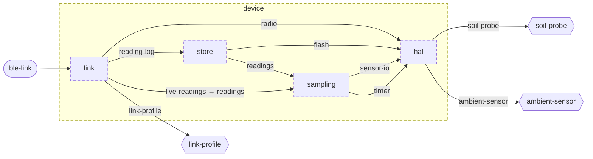

<!-- youmedoc:generated - do not edit; run `youmedoc generate` -->
# Component diagram: device

[device](../../README.md) · [context](context.md) · [architecture](architecture.md)

The units directly inside `device` and how they are wired. Arrows point from the side that needs something to the side that provides it. Rounded nodes are ports the framing unit provides, hexagons are its needs. Dashed arrows are alternative providers; dashed borders mark planned units.

| Unit | Summary | Status | Diagram |
|---|---|---|---|
| [device](../../README.md) | Firmware of the sensor stick that measures soil and surroundings and serves the readings over BLE | planned | [component](component.md) |
| [hal](../../hal/README.md) | Hardware abstraction of the sensor stick board | planned | [context](../../hal/doc/diagrams/context.md) |
| [link](../../link/README.md) | Implements the BLE profile on top of the radio | planned | [context](../../link/doc/diagrams/context.md) |
| [sampling](../../sampling/README.md) | Takes a calibrated reading at every sampling interval | planned | [context](../../sampling/doc/diagrams/context.md) |
| [store](../../store/README.md) | Keeps readings on the device until they have been delivered | planned | [context](../../store/doc/diagrams/context.md) |
