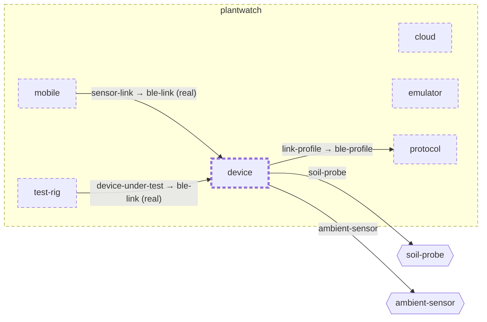

<!-- unifold:generated - do not edit; run `unifold generate` -->
# Context diagram: device

[plantwatch](../../../doc/diagrams/component.md) / **device** · [README](../../README.md) · [component](component.md) · [architecture](architecture.md)

`device` among its siblings inside `plantwatch`. Only connections that touch `device` are drawn. Arrows point from the side that needs something to the side that provides it. Rounded nodes are ports the framing unit provides, hexagons are its needs. A dashed arrow is an alternative provider; a dashed border marks a planned unit.

| Unit | Kind | Diagram |
|---|---|---|
| [plantwatch](../../../README.md) | system | [component](../../../doc/diagrams/component.md) |
| [cloud](../../../cloud/README.md) | system | [component](../../../cloud/doc/diagrams/component.md) |
| [device](../../README.md) | firmware | [component](component.md) |
| [emulator](../../../emulator/README.md) | tool | [context](../../../emulator/doc/diagrams/context.md) |
| [mobile](../../../mobile/README.md) | app | [component](../../../mobile/doc/diagrams/component.md) |
| [protocol](../../../protocol/README.md) | specification | [context](../../../protocol/doc/diagrams/context.md) |
| [test-rig](../../../test-rig/README.md) | test | [context](../../../test-rig/doc/diagrams/context.md) |

### Who provides what this unit needs

| Need | Kind | Own contract | Provided by | Port | Their contract |
|---|---|---|---|---|---|
| soil-probe | hardware |  | outside the project, as need `soil-probe` of the root | | |
| ambient-sensor | hardware |  | outside the project, as need `ambient-sensor` of the root | | |
| link-profile | specification |  | [protocol](../../../protocol/README.md) | ble-profile | [contract](../../../protocol/doc/references/ble-profile/index.md) |

### Who uses what this unit provides

| Port | Kind | Used by | As need | Their contract |
|---|---|---|---|---|
| ble-link | protocol | [mobile/ble-client](../../../mobile/ble-client/README.md) | sensor-link |  |
| ble-link | protocol | [test-rig](../../../test-rig/README.md) | device-under-test |  |
