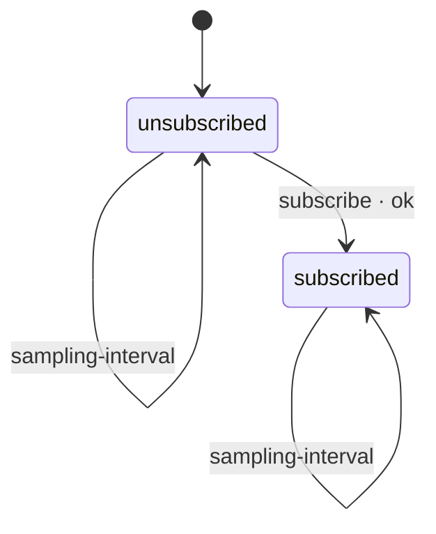

<!-- unifold:generated - do not edit; run `unifold check --fix` -->
# States: readings

The states of the contract [readings](../references/readings.md): what a consumer can see of the connection, and the parts that move it from one state to the next. A part that a state does not list must not be called in it. A failure that the table does not name leaves the state as it is.

| State | Part | Result | Next |
|---|---|---|---|
| unsubscribed | `subscribe` | ok | subscribed |
| unsubscribed | `subscribe` | too-many | unsubscribed |
| unsubscribed | `sampling-interval` |  | unsubscribed |
| subscribed | `new-reading` |  | subscribed |
| subscribed | `sampling-interval` |  | subscribed |
