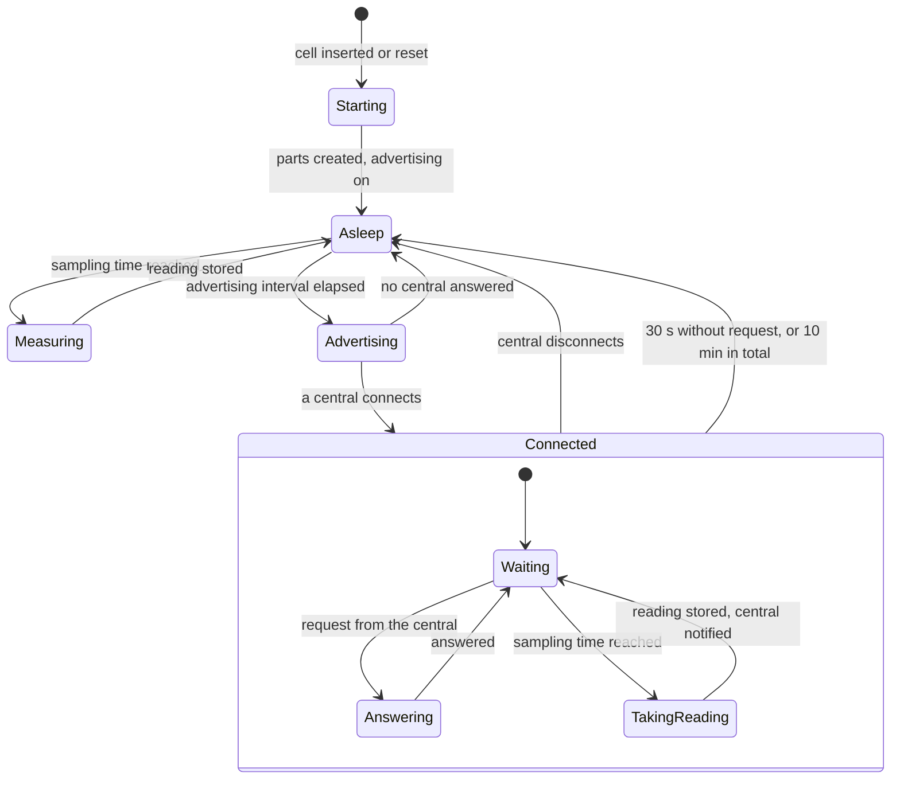

# Runtime of device

The scenarios that cross several parts and that no single part can tell:
the order of a start, and the states of the whole firmware over time. The
parts appear as the [component diagram](../diagrams/component.md) shows
them.

## Start

The start-up code creates the parts in this order, because each step
relies on the one before:

1. The hardware layer. The boot counter rises here.
2. The memory for readings. It recovers its state.
3. Measuring. The first reading is due within 10 s.
4. The BLE profile. It starts advertising last, so that a central
   never meets a sensor stick that cannot answer.

## The sleep and wake cycle

The board is asleep unless one of three things happens. The diagram shows
the states of the whole firmware, not of a single part.

| State | Typical duration | How often |
|---|---|---|
| Measuring | 260 ms, of which the processor runs about 10 ms | Every sampling interval |
| Advertising | 3 ms | Every 1285 ms while not connected |
| Connected | 3 to 5 s | About 4 times a day |
| Asleep | The rest: more than 99 % of the time | |

In the state Connected the board also sleeps between connection events.
"Waiting" means that the connection is held, not that the processor runs.
