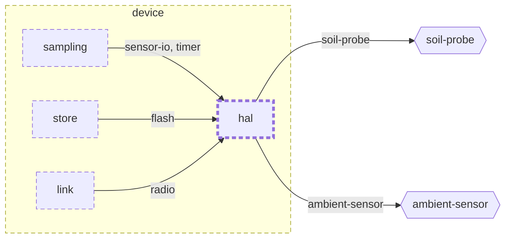

<!-- youmedoc:generated - do not edit; run `youmedoc generate` -->
# Context diagram: hal

[plantwatch](../../../../doc/diagrams/component.md) / [device](../../../doc/diagrams/component.md) / **hal** · [README](../../README.md)

`hal` among its siblings inside `device`. Only connections that touch `hal` are drawn. Arrows point from the side that needs something to the side that provides it. Rounded nodes are ports the framing unit provides, hexagons are its needs. A dashed arrow is an alternative provider; a dashed border marks a planned unit.

| Unit | Kind | Diagram |
|---|---|---|
| [device](../../../README.md) | firmware | [component](../../../doc/diagrams/component.md) |
| [hal](../../README.md) | library | [context](context.md) |
| [link](../../../link/README.md) | library | [context](../../../link/doc/diagrams/context.md) |
| [sampling](../../../sampling/README.md) | library | [context](../../../sampling/doc/diagrams/context.md) |
| [store](../../../store/README.md) | library | [context](../../../store/doc/diagrams/context.md) |

### Who provides what this unit needs

| Need | Kind | Own contract | Provided by | Port | Their contract |
|---|---|---|---|---|---|
| soil-probe | hardware |  | outside the project, as need `soil-probe` of the root | | |
| ambient-sensor | hardware |  | outside the project, as need `ambient-sensor` of the root | | |

### Who uses what this unit provides

| Port | Kind | Used by | As need | Their contract |
|---|---|---|---|---|
| sensor-io | library | [device/sampling](../../../sampling/README.md) | sensor-io | [contract](../../../sampling/doc/references/sensor-io.md) |
| radio | library | [device/link](../../../link/README.md) | radio | [contract](../../../link/doc/references/radio.md) |
| flash | library | [device/store](../../../store/README.md) | flash | [contract](../../../store/doc/references/flash.md) |
| timer | library | [device/sampling](../../../sampling/README.md) | timer | [contract](../../../sampling/doc/references/timer.md) |
