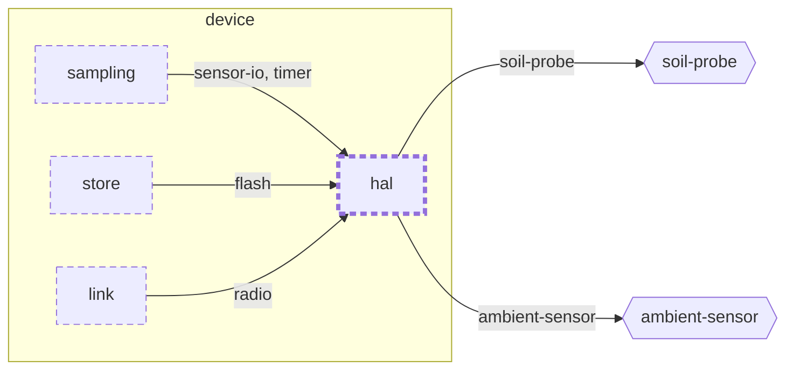

<!-- unifold:generated - do not edit; run `unifold generate` -->
# Context diagram: hal

[plantwatch](../../../../docs/diagrams/component.md) / [device](../../../docs/diagrams/component.md) / **hal** · [README](../../README.md)

`hal` inside `device`, with the units it is connected to. An arrow points from the unit that needs something to the unit that provides it. Rounded nodes are capabilities of the framing unit, hexagons are its needs. A dashed arrow is an alternative provider; a dashed border marks a unit that is planned.

| Unit | Kind | Summary | Status | Diagram |
|---|---|---|---|---|
| [hal](../../README.md) | library | Hardware abstraction of the sensor stick board | **planned** | [context](context.md) |
| [link](../../../link/README.md) | library | Implements the BLE profile on top of the radio | **planned** | [context](../../../link/docs/diagrams/context.md) |
| [sampling](../../../sampling/README.md) | library | Takes a calibrated reading at every sampling interval | **planned** | [context](../../../sampling/docs/diagrams/context.md) |
| [store](../../../store/README.md) | library | Keeps readings on the sensor stick until they have been delivered | **planned** | [context](../../../store/docs/diagrams/context.md) |

### Who provides what this unit needs

| Need | Kind | Contract | Provided by | Capability | Verified by |
|---|---|---|---|---|---|
| soil-probe | hardware | [contract](../../../../docs/references/soil-probe.md) | outside the project, as need `soil-probe` of the root (passed up by name) | | |
| ambient-sensor | hardware | [contract](../../../../docs/references/ambient-sensor.md) | outside the project, as need `ambient-sensor` of the root (passed up by name) | | |

### Who uses what this unit provides

| Capability | Kind | Contract | Verified by | Used by | As need |
|---|---|---|---|---|---|
| sensor-io | library | [contract](../../../docs/references/sensor-io.md) |  | [device/sampling](../../../sampling/README.md) (planned) | sensor-io |
| radio | library | [contract](../../../docs/references/radio.md) |  | [device/link](../../../link/README.md) (planned) | radio |
| flash | library | [contract](../../../docs/references/flash.md) |  | [device/store](../../../store/README.md) (planned) | flash |
| timer | library | [contract](../../../docs/references/timer.md) |  | [device/sampling](../../../sampling/README.md) (planned) | timer |
