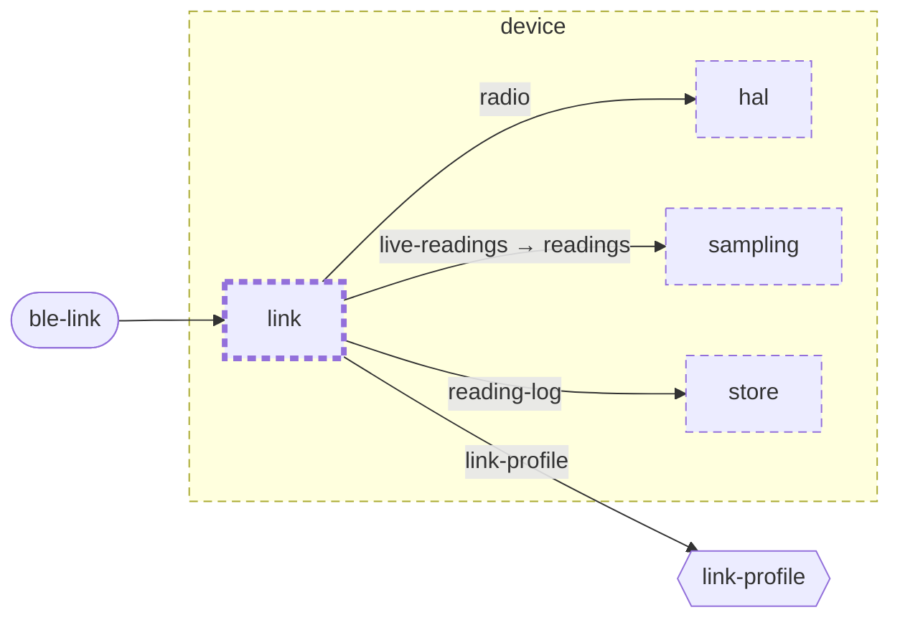

<!-- unifold:generated - do not edit; run `unifold generate` -->
# Context diagram: link

[plantwatch](../../../../doc/diagrams/component.md) / [device](../../../doc/diagrams/component.md) / **link** · [README](../../README.md)

`link` among its siblings inside `device`. Only connections that touch `link` are drawn. Arrows point from the side that needs something to the side that provides it. Rounded nodes are ports the framing unit provides, hexagons are its needs. A dashed arrow is an alternative provider; a dashed border marks a planned unit.

| Unit | Kind | Diagram |
|---|---|---|
| [device](../../../README.md) | firmware | [component](../../../doc/diagrams/component.md) |
| [hal](../../../hal/README.md) | library | [context](../../../hal/doc/diagrams/context.md) |
| [link](../../README.md) | library | [context](context.md) |
| [sampling](../../../sampling/README.md) | library | [context](../../../sampling/doc/diagrams/context.md) |
| [store](../../../store/README.md) | library | [context](../../../store/doc/diagrams/context.md) |

### Who provides what this unit needs

| Need | Kind | Own contract | Provided by | Port | Their contract |
|---|---|---|---|---|---|
| radio | library | [contract](../references/radio.md) | [device/hal](../../../hal/README.md) | radio | [contract](../../../hal/doc/references/radio.md) |
| reading-log | library |  | [device/store](../../../store/README.md) | reading-log |  |
| live-readings | library |  | [device/sampling](../../../sampling/README.md) | readings |  |
| link-profile | specification |  | [protocol](../../../../protocol/README.md) | ble-profile | [contract](../../../../protocol/doc/references/ble-profile/index.md) |

### Who uses what this unit provides

| Port | Kind | Used by | As need | Their contract |
|---|---|---|---|---|
| ble-link | protocol | [mobile/ble-client](../../../../mobile/ble-client/README.md) | sensor-link |  |
| ble-link | protocol | [test-rig](../../../../test-rig/README.md) | device-under-test |  |
