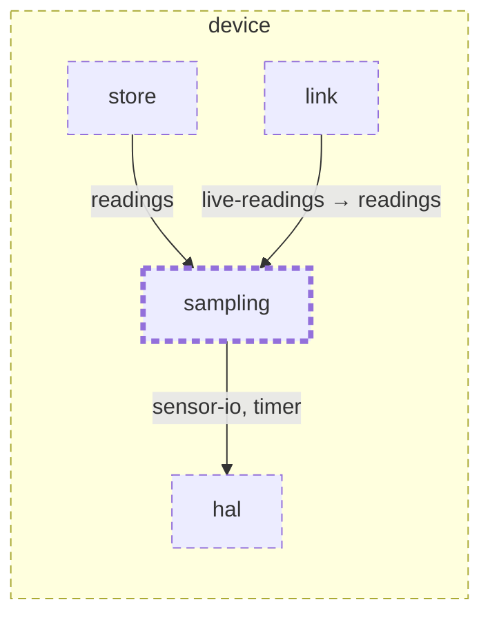

<!-- youmedoc:generated - do not edit; run `youmedoc generate` -->
# Context diagram: sampling

[plantwatch](../../../../doc/diagrams/component.md) / [device](../../../doc/diagrams/component.md) / **sampling** · [README](../../README.md)

`sampling` among its siblings inside `device`. Only connections that touch `sampling` are drawn. Arrows point from the side that needs something to the side that provides it. Rounded nodes are ports the framing unit provides, hexagons are its needs. A dashed arrow is an alternative provider; a dashed border marks a planned unit.

| Unit | Kind | Diagram |
|---|---|---|
| [device](../../../README.md) | firmware | [component](../../../doc/diagrams/component.md) |
| [hal](../../../hal/README.md) | library | [context](../../../hal/doc/diagrams/context.md) |
| [link](../../../link/README.md) | library | [context](../../../link/doc/diagrams/context.md) |
| [sampling](../../README.md) | library | [context](context.md) |
| [store](../../../store/README.md) | library | [context](../../../store/doc/diagrams/context.md) |

### Who provides what this unit needs

| Need | Kind | Own contract | Provided by | Port | Their contract |
|---|---|---|---|---|---|
| sensor-io | library | [contract](../references/sensor-io.md) | [device/hal](../../../hal/README.md) | sensor-io | [contract](../../../hal/doc/references/sensor-io.md) |
| timer | library | [contract](../references/timer.md) | [device/hal](../../../hal/README.md) | timer | [contract](../../../hal/doc/references/timer.md) |

### Who uses what this unit provides

| Port | Kind | Used by | As need | Their contract |
|---|---|---|---|---|
| readings | library | [device/store](../../../store/README.md) | readings |  |
| readings | library | [device/link](../../../link/README.md) | live-readings |  |
