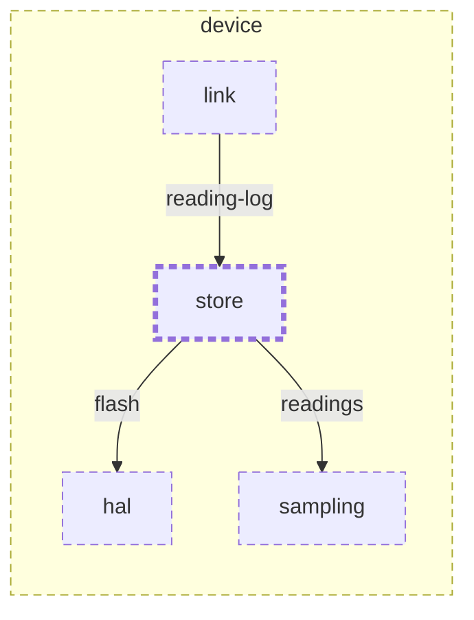

<!-- youmedoc:generated - do not edit; run `youmedoc generate` -->
# Context diagram: store

[plantwatch](../../../../doc/diagrams/component.md) / [device](../../../doc/diagrams/component.md) / **store** · [README](../../README.md)

`store` among its siblings inside `device`. Only connections that touch `store` are drawn. Arrows point from the side that needs something to the side that provides it. Rounded nodes are ports the framing unit provides, hexagons are its needs. A dashed arrow is an alternative provider; a dashed border marks a planned unit.

| Unit | Kind | Diagram |
|---|---|---|
| [device](../../../README.md) | firmware | [component](../../../doc/diagrams/component.md) |
| [hal](../../../hal/README.md) | library | [context](../../../hal/doc/diagrams/context.md) |
| [link](../../../link/README.md) | library | [context](../../../link/doc/diagrams/context.md) |
| [sampling](../../../sampling/README.md) | library | [context](../../../sampling/doc/diagrams/context.md) |
| [store](../../README.md) | library | [context](context.md) |

### Who provides what this unit needs

| Need | Kind | Own contract | Provided by | Port | Their contract |
|---|---|---|---|---|---|
| flash | library | [contract](../references/flash.md) | [device/hal](../../../hal/README.md) | flash | [contract](../../../hal/doc/references/flash.md) |
| readings | library |  | [device/sampling](../../../sampling/README.md) | readings |  |

### Who uses what this unit provides

| Port | Kind | Used by | As need | Their contract |
|---|---|---|---|---|
| reading-log | library | [device/link](../../../link/README.md) | reading-log |  |
