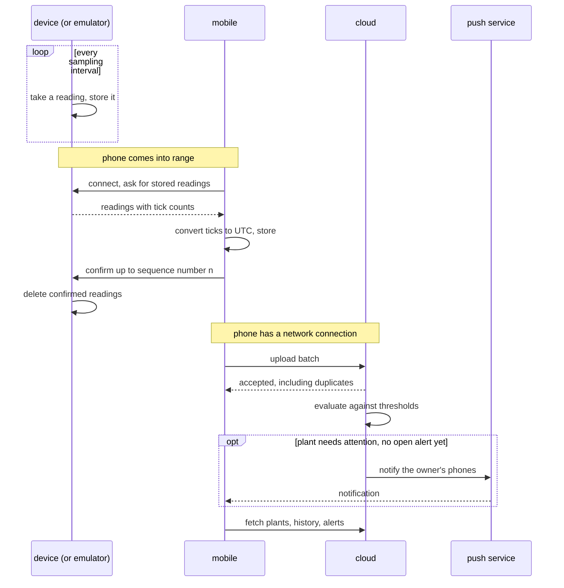

# Architecture of plantwatch

The long form of the why in [AGENTS.md](../AGENTS.md). Which parts exist and
how they are wired is shown in the [component diagram](diagrams/component.md).

## Reasoning

**Battery life decides the radio.** A sensor stick runs for a year on a coin
cell only if it sleeps almost always. That rules out Wi-Fi and leaves
Bluetooth Low Energy. BLE reaches a phone, not the internet, so a phone has to
carry the readings onward
([0001](decisions/0001-the-phone-relays-between-sensor-and-server.md)).

**A relay that is often absent decides the data model.** The phone may be
away for days. Readings therefore wait on the sensor stick, travel in batches,
and may be sent twice when a transfer is interrupted. Every hop is allowed to
deliver a reading more than once, and every receiver recognises a reading it
already has
([0004](decisions/0004-readings-are-immutable-and-identified-by-sensor-and-sequence.md)).

**No clock on the sensor stick decides who assigns time.** A coin-cell device
without a network has no trustworthy wall clock. It counts ticks; the phone,
which knows the time, converts ticks to UTC when it fetches
([0005](decisions/0005-the-sensor-counts-ticks-and-the-phone-assigns-time.md)).

**Shared definitions get an owner.** The radio protocol and the reading format
are used by several parts and owned by none, so they have a unit of their own
([0002](decisions/0002-define-the-profile-and-the-reading-format-once.md)).

## Invariants

Invariants that the parts must obey are also recorded as decisions or in the
[conventions](references/conventions.md), so that the parts can cite them.

- A reading that has been taken is never changed, at any place.
- A reading is deleted from a place only after the next place has confirmed
  that it has it.
- Exactly one part talks to both a sensor stick and the server: the phone
  app.
- No part other than the server side decides whether a plant needs
  attention. The phone app shows what the server decided
  ([0006](decisions/0006-the-server-side-alone-decides-what-needs-attention.md)).
- Within one major version of the radio protocol, a newer part works with an
  older counterpart.

## The path of a reading

This sequence crosses several parts and is therefore drawn here. It shows
only the parts directly inside plantwatch and the outside world.

## Where things run

| Part | Runs on | Released as |
|---|---|---|
| [device](../device/README.md) | The sensor stick's microcontroller | Firmware image, updated by hand in version 1 |
| [mobile](../mobile/README.md) | The user's phone | App store release |
| [cloud](../cloud/README.md) | A container host | Container images |
| [emulator](../emulator/README.md) | A developer machine or CI runner | Not released |
| [test-rig](../test-rig/README.md) | A developer machine or CI runner, optionally next to real hardware | Not released |
| [protocol](../protocol/README.md) | Nowhere; it is a definition | Versioned documents |

## What version 1 leaves out

- Firmware updates over the air.
- More than one owner per plant.
- A web client. The public API of the server side would allow one.
