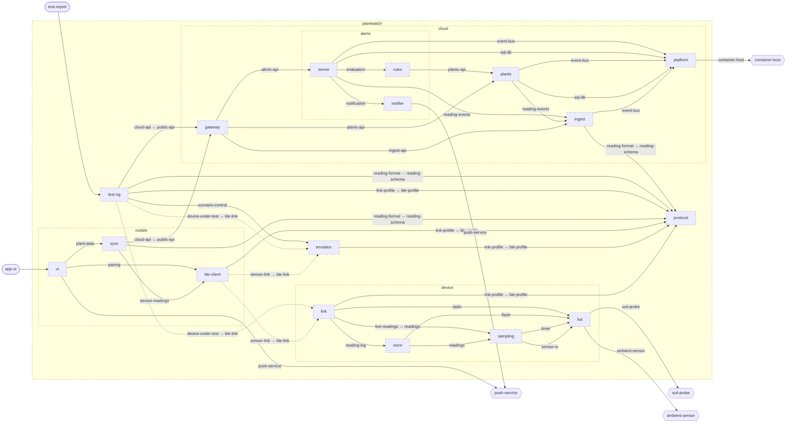

<!-- youmedoc:generated - do not edit; run `youmedoc generate` -->
# Architecture diagram: plantwatch

[plantwatch](../../README.md) · [context](context.md) · [component](component.md)

`plantwatch`, opened up to 3 level(s) down. Arrows point from the side that needs something to the side that provides it. Rounded nodes are ports the framing unit provides, hexagons are its needs. Dashed arrows are alternative providers; dashed borders mark planned units.

| Unit | Summary | Status | Diagram |
|---|---|---|---|
| [plantwatch](../../README.md) | Tells people when their house plants need water, using a sensor in the pot, a phone app and cloud services | planned | [component](component.md) |
| [cloud](../../cloud/README.md) | Server side that stores readings, keeps the plant registry and raises alerts | planned | [component](../../cloud/doc/diagrams/component.md) |
| [platform](../../cloud/platform/README.md) | Shared infrastructure of the services - message bus and database | planned | [context](../../cloud/platform/doc/diagrams/context.md) |
| [alerts](../../cloud/services/alerts/README.md) | Decides when a plant needs attention and notifies its owner once | planned | [component](../../cloud/services/alerts/doc/diagrams/component.md) |
| [notifier](../../cloud/services/alerts/notifier/README.md) | Turns an opened alert into one notification to the owner | planned | [context](../../cloud/services/alerts/notifier/doc/diagrams/context.md) |
| [rules](../../cloud/services/alerts/rules/README.md) | Evaluates readings against the thresholds of a plant | planned | [context](../../cloud/services/alerts/rules/doc/diagrams/context.md) |
| [server](../../cloud/services/alerts/server/README.md) | Process of the alerts service - consumes readings, stores alerts and answers queries | planned | [context](../../cloud/services/alerts/server/doc/diagrams/context.md) |
| [gateway](../../cloud/services/gateway/README.md) | Single entry point of the server side that authenticates callers and routes requests | planned | [context](../../cloud/services/gateway/doc/diagrams/context.md) |
| [ingest](../../cloud/services/ingest/README.md) | Accepts uploaded readings, validates them and publishes each one once | planned | [context](../../cloud/services/ingest/doc/diagrams/context.md) |
| [plants](../../cloud/services/plants/README.md) | Registry of plants with their sensors, thresholds and reading history | planned | [context](../../cloud/services/plants/doc/diagrams/context.md) |
| [device](../../device/README.md) | Firmware of the sensor stick that measures soil and surroundings and serves the readings over BLE | planned | [component](../../device/doc/diagrams/component.md) |
| [hal](../../device/hal/README.md) | Hardware abstraction of the sensor stick board | planned | [context](../../device/hal/doc/diagrams/context.md) |
| [link](../../device/link/README.md) | Implements the BLE profile on top of the radio | planned | [context](../../device/link/doc/diagrams/context.md) |
| [sampling](../../device/sampling/README.md) | Takes a calibrated reading at every sampling interval | planned | [context](../../device/sampling/doc/diagrams/context.md) |
| [store](../../device/store/README.md) | Keeps readings on the device until they have been delivered | planned | [context](../../device/store/doc/diagrams/context.md) |
| [emulator](../../emulator/README.md) | Desktop program that behaves like a sensor stick and is driven by a scenario instead of hardware | planned | [context](../../emulator/doc/diagrams/context.md) |
| [mobile](../../mobile/README.md) | Phone app that collects readings from sensor sticks, shows the plants and relays data to the server | planned | [component](../../mobile/doc/diagrams/component.md) |
| [ble-client](../../mobile/ble-client/README.md) | Finds sensor sticks and fetches their readings over BLE | planned | [context](../../mobile/ble-client/doc/diagrams/context.md) |
| [sync](../../mobile/sync/README.md) | Keeps plants, history and alerts on the phone and in step with the server | planned | [context](../../mobile/sync/doc/diagrams/context.md) |
| [ui](../../mobile/ui/README.md) | Screens of the phone app | planned | [context](../../mobile/ui/doc/diagrams/context.md) |
| [protocol](../../protocol/README.md) | Defines the BLE profile of the sensor stick and the format of a reading | planned | [context](../../protocol/doc/diagrams/context.md) |
| [test-rig](../../test-rig/README.md) | Runs end-to-end tests from the sensor link to the alert, against real or simulated hardware | planned | [context](../../test-rig/doc/diagrams/context.md) |
