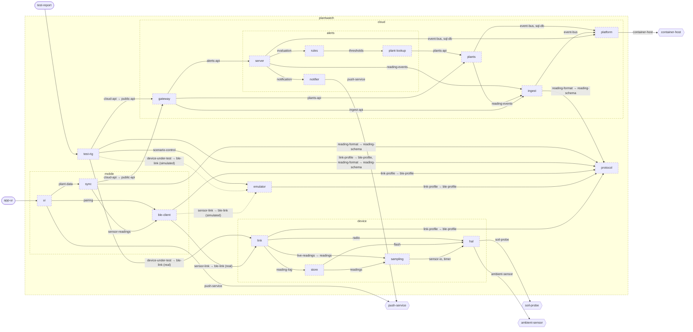

<!-- youmedoc:generated - do not edit; run `youmedoc generate` -->
# Architecture diagram: plantwatch

**plantwatch** · [README](../../README.md) · [context](context.md) · [component](component.md)

`plantwatch`, opened up 3 level(s) down. Arrows point from the side that needs something to the side that provides it. Rounded nodes are ports the framing unit provides, hexagons are its needs. A dashed arrow is an alternative provider; a dashed border marks a planned unit.

| Unit | Kind | Diagram |
|---|---|---|
| [plantwatch](../../README.md) | system | [component](component.md) |
| [cloud](../../cloud/README.md) | system | [component](../../cloud/doc/diagrams/component.md) |
| [platform](../../cloud/platform/README.md) | infrastructure | [context](../../cloud/platform/doc/diagrams/context.md) |
| [alerts](../../cloud/services/alerts/README.md) | service | [component](../../cloud/services/alerts/doc/diagrams/component.md) |
| [notifier](../../cloud/services/alerts/notifier/README.md) | adapter | [context](../../cloud/services/alerts/notifier/doc/diagrams/context.md) |
| [plant-lookup](../../cloud/services/alerts/plant-lookup/README.md) | adapter | [context](../../cloud/services/alerts/plant-lookup/doc/diagrams/context.md) |
| [rules](../../cloud/services/alerts/rules/README.md) | library | [context](../../cloud/services/alerts/rules/doc/diagrams/context.md) |
| [server](../../cloud/services/alerts/server/README.md) | app | [context](../../cloud/services/alerts/server/doc/diagrams/context.md) |
| [gateway](../../cloud/services/gateway/README.md) | service | [context](../../cloud/services/gateway/doc/diagrams/context.md) |
| [ingest](../../cloud/services/ingest/README.md) | service | [context](../../cloud/services/ingest/doc/diagrams/context.md) |
| [plants](../../cloud/services/plants/README.md) | service | [context](../../cloud/services/plants/doc/diagrams/context.md) |
| [device](../../device/README.md) | firmware | [component](../../device/doc/diagrams/component.md) |
| [hal](../../device/hal/README.md) | library | [context](../../device/hal/doc/diagrams/context.md) |
| [link](../../device/link/README.md) | library | [context](../../device/link/doc/diagrams/context.md) |
| [sampling](../../device/sampling/README.md) | library | [context](../../device/sampling/doc/diagrams/context.md) |
| [store](../../device/store/README.md) | library | [context](../../device/store/doc/diagrams/context.md) |
| [emulator](../../emulator/README.md) | tool | [context](../../emulator/doc/diagrams/context.md) |
| [mobile](../../mobile/README.md) | app | [component](../../mobile/doc/diagrams/component.md) |
| [ble-client](../../mobile/ble-client/README.md) | library | [context](../../mobile/ble-client/doc/diagrams/context.md) |
| [sync](../../mobile/sync/README.md) | library | [context](../../mobile/sync/doc/diagrams/context.md) |
| [ui](../../mobile/ui/README.md) | library | [context](../../mobile/ui/doc/diagrams/context.md) |
| [protocol](../../protocol/README.md) | specification | [context](../../protocol/doc/diagrams/context.md) |
| [test-rig](../../test-rig/README.md) | test | [context](../../test-rig/doc/diagrams/context.md) |
