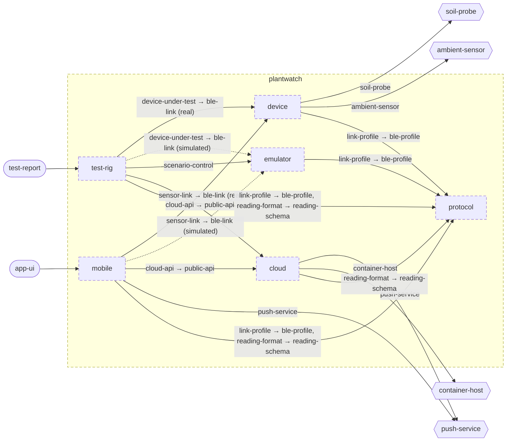

<!-- youmedoc:generated - do not edit; run `youmedoc generate` -->
# Component diagram: plantwatch

**plantwatch** · [README](../../README.md) · [context](context.md) · [architecture](architecture.md)

The units directly inside `plantwatch` and how they are wired. Arrows point from the side that needs something to the side that provides it. Rounded nodes are ports the framing unit provides, hexagons are its needs. A dashed arrow is an alternative provider; a dashed border marks a planned unit.

| Unit | Kind | Summary | Status | Diagram |
|---|---|---|---|---|
| [plantwatch](../../README.md) | system | Tells people when their house plants need water, using a sensor in the pot, a phone app and cloud services | planned | [component](component.md) |
| [cloud](../../cloud/README.md) | system | Server side that turns uploaded readings into plant history and alerts | planned | [component](../../cloud/doc/diagrams/component.md) |
| [device](../../device/README.md) | firmware | Firmware of the sensor stick that measures soil and surroundings and serves the readings over BLE | planned | [component](../../device/doc/diagrams/component.md) |
| [emulator](../../emulator/README.md) | tool | Desktop program that behaves like a sensor stick and is driven by a scenario instead of hardware | planned | [context](../../emulator/doc/diagrams/context.md) |
| [mobile](../../mobile/README.md) | app | Phone app that collects readings from sensor sticks, shows the plants and relays data to the server | planned | [component](../../mobile/doc/diagrams/component.md) |
| [protocol](../../protocol/README.md) | specification | Defines the BLE profile of the sensor stick and the format of a reading | planned | [context](../../protocol/doc/diagrams/context.md) |
| [test-rig](../../test-rig/README.md) | test | Runs end-to-end tests from the sensor link to the alert, against real or simulated hardware | planned | [context](../../test-rig/doc/diagrams/context.md) |
