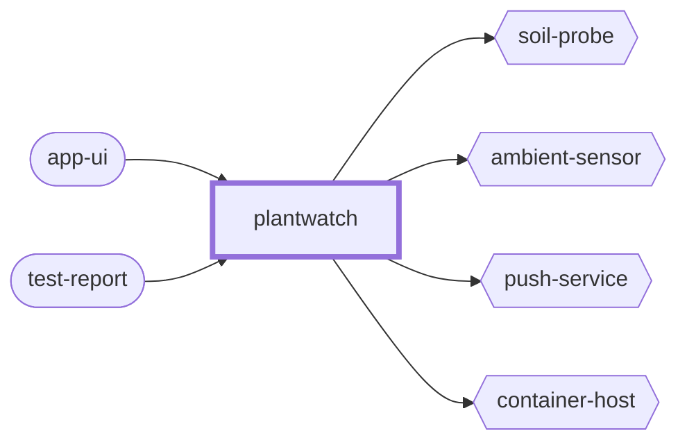

<!-- youmedoc:generated - do not edit; run `youmedoc generate` -->
# Context diagram: plantwatch

[plantwatch](../../README.md) · [component](component.md) · [architecture](architecture.md)

`plantwatch` and the outside world: the ports it provides (rounded) and the things it needs from outside (hexagons).

| Port | Direction | Kind | Summary |
|---|---|---|---|
| app-ui | provided | ui | Shows the state of each plant and tells the user when to water it |
| test-report | provided | file | Result of the automated end-to-end tests, for developers and CI |
| soil-probe | needed | hardware | Capacitive soil moisture probe with an analogue output |
| ambient-sensor | needed | hardware | Light and temperature sensor on an I2C bus |
| push-service | needed | http | Delivers a notification to a phone, for example APNs or FCM |
| container-host | needed | infrastructure | Runs containers, gives them a private network and persistent volumes |
