<!-- unifold:generated - do not edit; run `unifold generate` -->
# Architecture diagram: plantwatch

**plantwatch** · [README](../../README.md) · [component](component.md)

`plantwatch` opened up 3 levels deep. An arrow points from the unit that needs something to the unit that provides it. Rounded nodes are capabilities of the framing unit, hexagons are its needs. A dashed arrow is an alternative provider; a dashed border marks a unit that is planned.

```mermaid
flowchart LR
  subgraph u_root["plantwatch"]
    subgraph u_cloud["cloud (system)"]
      u_cloud__platform["platform (adapter)"]
      subgraph u_cloud__services__alerts["alerts (service)"]
        u_cloud__services__alerts__notifier["notifier (adapter)"]
        u_cloud__services__alerts__plant_dlookup["plant-lookup (adapter)"]
        u_cloud__services__alerts__rules["rules (library)"]
        u_cloud__services__alerts__server["server (app)"]
      end
      u_cloud__services__gateway["gateway (service)"]
      u_cloud__services__ingest["ingest (service)"]
      u_cloud__services__plants["plants (service)"]
    end
    subgraph u_device["device (firmware)"]
      u_device__hal["hal (adapter)"]
      u_device__link["link (library)"]
      u_device__sampling["sampling (library)"]
      u_device__store["store (library)"]
    end
    u_emulator["emulator (tool)"]
    subgraph u_mobile["mobile (app)"]
      u_mobile__ble_dclient["ble-client (library)"]
      u_mobile__sync["sync (library)"]
      u_mobile__ui["ui (adapter)"]
    end
    u_test_drig["test-rig (test)"]
  end
  n_root___push_dservice{{"push-service"}}
  n_root___container_dhost{{"container-host"}}
  n_root___ambient_dsensor{{"ambient-sensor"}}
  n_root___soil_dprobe{{"soil-probe"}}
  p_root___app_dui(["app-ui"])
  p_root___test_dreport(["test-report"])
  u_mobile__ble_dclient -->|"sensor-link → ble-link (real)"| u_device__link
  u_mobile__ble_dclient -.->|"sensor-link → ble-link (simulated)"| u_emulator
  u_mobile__sync -->|"cloud-api → public-api"| u_cloud__services__gateway
  u_mobile__ui -->|"push-service"| n_root___push_dservice
  u_cloud__services__alerts__notifier -->|"push-service"| n_root___push_dservice
  u_test_drig -->|"device-under-test → ble-link (real)"| u_device__link
  u_test_drig -.->|"device-under-test → ble-link (simulated)"| u_emulator
  u_test_drig -->|"scenario-control (optional)"| u_emulator
  u_test_drig -->|"cloud-api → public-api"| u_cloud__services__gateway
  u_cloud__platform -->|"container-host"| n_root___container_dhost
  u_device__hal -->|"ambient-sensor"| n_root___ambient_dsensor
  u_device__hal -->|"soil-probe"| n_root___soil_dprobe
  p_root___app_dui --> u_mobile__ui
  p_root___test_dreport --> u_test_drig
  u_cloud__services__ingest -->|"event-bus"| u_cloud__platform
  u_cloud__services__plants -->|"event-bus, sql-db"| u_cloud__platform
  u_cloud__services__alerts__server -->|"event-bus, sql-db"| u_cloud__platform
  u_cloud__services__gateway -->|"ingest-api"| u_cloud__services__ingest
  u_cloud__services__gateway -->|"plants-api"| u_cloud__services__plants
  u_cloud__services__gateway -->|"alerts-api"| u_cloud__services__alerts__server
  u_cloud__services__plants -->|"reading-events"| u_cloud__services__ingest
  u_cloud__services__alerts__server -->|"reading-events"| u_cloud__services__ingest
  u_cloud__services__alerts__plant_dlookup -->|"plants-api"| u_cloud__services__plants
  u_cloud__services__alerts__server -->|"evaluation"| u_cloud__services__alerts__rules
  u_cloud__services__alerts__server -->|"notification"| u_cloud__services__alerts__notifier
  u_cloud__services__alerts__rules -->|"thresholds"| u_cloud__services__alerts__plant_dlookup
  u_device__sampling -->|"sensor-io, timer"| u_device__hal
  u_device__store -->|"flash"| u_device__hal
  u_device__store -->|"readings"| u_device__sampling
  u_device__link -->|"radio"| u_device__hal
  u_device__link -->|"reading-log"| u_device__store
  u_device__link -->|"live-readings → readings"| u_device__sampling
  u_mobile__sync -->|"sensor-readings"| u_mobile__ble_dclient
  u_mobile__ui -->|"plant-data"| u_mobile__sync
  u_mobile__ui -->|"pairing"| u_mobile__ble_dclient
  classDef focus stroke-width:4px
  classDef planned stroke-dasharray:6 4
  classDef deprecated stroke-dasharray:2 2,opacity:0.6
  classDef plain stroke-dasharray:2 3
  class u_cloud,u_cloud__platform,u_cloud__services__alerts,u_cloud__services__alerts__notifier,u_cloud__services__alerts__plant_dlookup,u_cloud__services__alerts__rules,u_cloud__services__alerts__server,u_cloud__services__gateway,u_cloud__services__ingest,u_cloud__services__plants,u_device,u_device__hal,u_device__link,u_device__sampling,u_device__store,u_emulator,u_mobile,u_mobile__ble_dclient,u_mobile__sync,u_mobile__ui,u_test_drig planned
```

| Unit | Kind | Responsibility | Status | Diagram |
|---|---|---|---|---|
| [cloud](../../cloud/README.md) | system | Server side that turns uploaded readings into plant history and alerts | **planned** | [component](../../cloud/docs/diagrams/component.md) |
| [platform](../../cloud/platform/README.md) | adapter | Shared infrastructure of the services - message bus and database | **planned** | [context](../../cloud/platform/docs/diagrams/context.md) |
| [alerts](../../cloud/services/alerts/README.md) | service | Decides when a plant needs attention and notifies its owner once | **planned** | [component](../../cloud/services/alerts/docs/diagrams/component.md) |
| [notifier](../../cloud/services/alerts/notifier/README.md) | adapter | Turns an opened alert into one notification to the owner | **planned** | [context](../../cloud/services/alerts/notifier/docs/diagrams/context.md) |
| [plant-lookup](../../cloud/services/alerts/plant-lookup/README.md) | adapter | Looks up the plant a sensor stick is attached to, with owner and thresholds, in the registry of plants | **planned** | [context](../../cloud/services/alerts/plant-lookup/docs/diagrams/context.md) |
| [rules](../../cloud/services/alerts/rules/README.md) | library | Evaluates readings against the thresholds of a plant | **planned** | [context](../../cloud/services/alerts/rules/docs/diagrams/context.md) |
| [server](../../cloud/services/alerts/server/README.md) | app | Process that consumes readings, stores the alerts they lead to and answers queries about them | **planned** | [context](../../cloud/services/alerts/server/docs/diagrams/context.md) |
| [gateway](../../cloud/services/gateway/README.md) | service | Single entry point of the server side that authenticates callers and routes requests | **planned** | [context](../../cloud/services/gateway/docs/diagrams/context.md) |
| [ingest](../../cloud/services/ingest/README.md) | service | Accepts uploaded readings and announces each accepted one as an event | **planned** | [context](../../cloud/services/ingest/docs/diagrams/context.md) |
| [plants](../../cloud/services/plants/README.md) | service | Registry of plants with their sensors, thresholds and reading history | **planned** | [context](../../cloud/services/plants/docs/diagrams/context.md) |
| [device](../../device/README.md) | firmware | Firmware of the sensor stick that measures soil and surroundings and serves the readings over BLE | **planned** | [component](../../device/docs/diagrams/component.md) |
| [hal](../../device/hal/README.md) | adapter | Hardware abstraction of the sensor stick board | **planned** | [context](../../device/hal/docs/diagrams/context.md) |
| [link](../../device/link/README.md) | library | Implements the BLE profile on top of the radio | **planned** | [context](../../device/link/docs/diagrams/context.md) |
| [sampling](../../device/sampling/README.md) | library | Takes a calibrated reading at every sampling interval | **planned** | [context](../../device/sampling/docs/diagrams/context.md) |
| [store](../../device/store/README.md) | library | Keeps readings on the sensor stick until they have been delivered | **planned** | [context](../../device/store/docs/diagrams/context.md) |
| [emulator](../../emulator/README.md) | tool | Desktop program that behaves like a sensor stick and is driven by a scenario instead of hardware | **planned** | [context](../../emulator/docs/diagrams/context.md) |
| [mobile](../../mobile/README.md) | app | Phone app that collects readings from sensor sticks, shows the plants and relays data to the server | **planned** | [component](../../mobile/docs/diagrams/component.md) |
| [ble-client](../../mobile/ble-client/README.md) | library | Finds sensor sticks and fetches their readings over BLE | **planned** | [context](../../mobile/ble-client/docs/diagrams/context.md) |
| [sync](../../mobile/sync/README.md) | library | Keeps plants, history and alerts on the phone and in step with the server | **planned** | [context](../../mobile/sync/docs/diagrams/context.md) |
| [ui](../../mobile/ui/README.md) | adapter | Screens of the phone app | **planned** | [context](../../mobile/ui/docs/diagrams/context.md) |
| [test-rig](../../test-rig/README.md) | test | Runs end-to-end tests from the sensor link to the alert, against real or simulated hardware | **planned** | [context](../../test-rig/docs/diagrams/context.md) |
