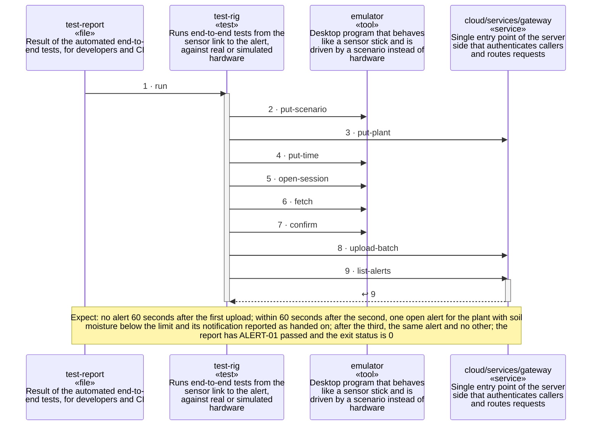

<!-- unifold:generated - do not edit; run `unifold generate` -->
# Scenario: end-to-end-alert-test

**plantwatch** · [README](../../README.md) · [component](component.md) · [architecture](architecture.md)

**The rig drives the simulated sensor stick through a dry spell and sees one alert**
Source: test catalogue of test-rig, ALERT-01
Expect: no alert 60 seconds after the first upload; within 60 seconds after the second, one open alert for the plant with soil moisture below the limit and its notification reported as handed on; after the third, the same alert and no other; the report has ALERT-01 passed and the exit status is 0

A unit is named by its path from `plantwatch`; a capability or need of `plantwatch` is named bare. Every step is one hop along one connection of the map, drawn as the kind of its part says: a command or query goes from the caller to the target, and a dashed arrow brings the result of a query back; an event goes from the provider that raises it to the caller that receives it, with an open arrowhead. A bar is the time a lifeline is busy with a step; it ends when a lifeline further out makes the next step, and a unit below the busy one acts for it. An event from an idle lifeline lands on the bar of a busy receiver, or starts one.

| # | Caller | Target | Part | Kind | Contract |
|---|---|---|---|---|---|
| 1 | `test-report` | `test-rig` | `run` | command | [test-report](../references/test-report.md) |
| 2 | `test-rig` | `emulator` | `put-scenario` | command | [index](../references/scenario-control/index.md) |
| 3 | `test-rig` | `cloud/services/gateway` | `put-plant` | command | [index](../references/public-api/index.md) |
| 4 | `test-rig` | `emulator` | `put-time` | command | [index](../references/scenario-control/index.md) |
| 5 | `test-rig` | `emulator` | `open-session` | command | [index](../references/ble-profile/index.md) |
| 6 | `test-rig` | `emulator` | `fetch` | command | [index](../references/ble-profile/index.md) |
| 7 | `test-rig` | `emulator` | `confirm` | command | [index](../references/ble-profile/index.md) |
| 8 | `test-rig` | `cloud/services/gateway` | `upload-batch` | command | [index](../references/public-api/index.md) |
| 9 | `test-rig` | `cloud/services/gateway` | `list-alerts` | query | [index](../references/public-api/index.md) |
