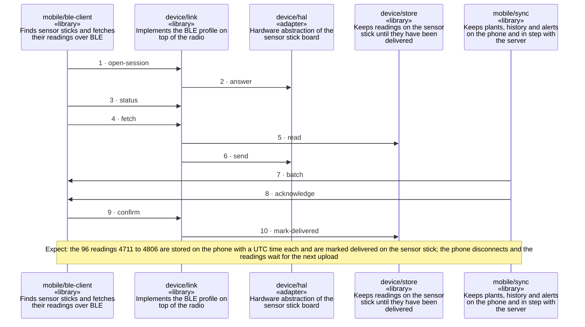

<!-- unifold:generated - do not edit; run `unifold generate` -->
# Scenario: fetch-readings

**plantwatch** · [README](../../README.md) · [component](component.md) · [architecture](architecture.md)

**A paired sensor stick comes into range and the phone fetches, stores and confirms its readings**
Source: BLE profile, fetch stored readings and confirm
Expect: the 96 readings 4711 to 4806 are stored on the phone with a UTC time each and are marked delivered on the sensor stick; the phone disconnects and the readings wait for the next upload

A unit is named by its path from `plantwatch`; a capability or need of `plantwatch` is named bare. Every hop is a call along one connection of the map.

| # | Caller | Target | Part | Contract |
|---|---|---|---|---|
| 1 | `mobile/ble-client` | `device/link` | `open-session` | [index](../references/ble-profile/index.md) |
| 2 | `device/link` | `device/hal` | `answer` | [radio](../../device/docs/references/radio.md) |
| 3 | `mobile/ble-client` | `device/link` | `status` | [index](../references/ble-profile/index.md) |
| 4 | `mobile/ble-client` | `device/link` | `fetch` | [index](../references/ble-profile/index.md) |
| 5 | `device/link` | `device/store` | `read` | [reading-log](../../device/docs/references/reading-log.md) |
| 6 | `device/link` | `device/hal` | `send` | [radio](../../device/docs/references/radio.md) |
| 7 | `mobile/sync` | `mobile/ble-client` | `batch` | [sensor-readings](../../mobile/docs/references/sensor-readings.md) |
| 8 | `mobile/sync` | `mobile/ble-client` | `acknowledge` | [sensor-readings](../../mobile/docs/references/sensor-readings.md) |
| 9 | `mobile/ble-client` | `device/link` | `confirm` | [index](../references/ble-profile/index.md) |
| 10 | `device/link` | `device/store` | `mark-delivered` | [reading-log](../../device/docs/references/reading-log.md) |
