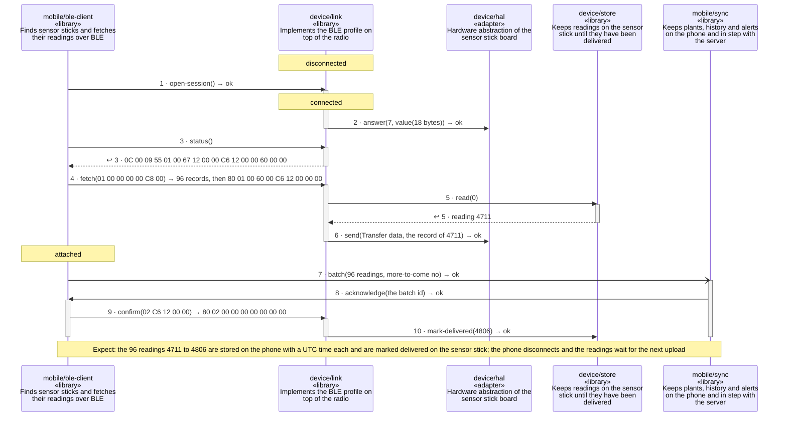

<!-- unifold:generated - do not edit; run `unifold check --fix` -->
# Scenario: fetch-readings

**plantwatch** · [README](../../README.md) · [component](component.md) · [architecture](architecture.md)

**A paired sensor stick comes into range and the phone fetches, stores and confirms its readings**
Source: BLE profile, fetch stored readings and confirm
Given: `mobile/ble-client.sensor-readings` is attached
Expect: the 96 readings 4711 to 4806 are stored on the phone with a UTC time each and are marked delivered on the sensor stick; the phone disconnects and the readings wait for the next upload

A unit is named by its path from `plantwatch`; a capability or need of `plantwatch` is named bare. Every step is one hop along one connection of the map, drawn as the kind of its part says: a command or query goes from the caller to the target, and a dashed arrow brings the result of a query back; an event goes from the provider that raises it to the caller that receives it, with an open arrowhead. A bar is the time a lifeline is busy with a step; it ends when a lifeline further out makes the next step, and a unit below the busy one acts for it. An event from an idle lifeline lands on the bar of a busy receiver, or starts one. A step shows its result; a note on a provider's lifeline shows the state of a connection whose contract has states.

| # | Caller | Target | Call | Kind | Result | State | Contract |
|---|---|---|---|---|---|---|---|
| 1 | `mobile/ble-client` | `device/link` | `open-session()` | command | ok | connected | [ble-profile](../references/ble-profile/index.md) |
| 2 | `device/link` | `device/hal` | `answer(7, value(18 bytes))` | command | ok |  | [radio](../../device/docs/references/radio.md) |
| 3 | `mobile/ble-client` | `device/link` | `status()` | query | 0C 00 09 55 01 00 67 12 00 00 C6 12 00 00 60 00 00 | connected | [ble-profile](../references/ble-profile/index.md) |
| 4 | `mobile/ble-client` | `device/link` | `fetch(01 00 00 00 00 C8 00)` | command | 96 records, then 80 01 00 60 00 C6 12 00 00 00 | connected | [ble-profile](../references/ble-profile/index.md) |
| 5 | `device/link` | `device/store` | `read(0)` | query | reading 4711 |  | [reading-log](../../device/docs/references/reading-log.md) |
| 6 | `device/link` | `device/hal` | `send(Transfer data, the record of 4711)` | command | ok |  | [radio](../../device/docs/references/radio.md) |
| 7 | `mobile/sync` | `mobile/ble-client` | `batch(96 readings, more-to-come no)` | event | ok | attached | [sensor-readings](../../mobile/docs/references/sensor-readings.md) |
| 8 | `mobile/sync` | `mobile/ble-client` | `acknowledge(the batch id)` | command | ok | attached | [sensor-readings](../../mobile/docs/references/sensor-readings.md) |
| 9 | `mobile/ble-client` | `device/link` | `confirm(02 C6 12 00 00)` | command | 80 02 00 00 00 00 00 00 00 | connected | [ble-profile](../references/ble-profile/index.md) |
| 10 | `device/link` | `device/store` | `mark-delivered(4806)` | command | ok |  | [reading-log](../../device/docs/references/reading-log.md) |
