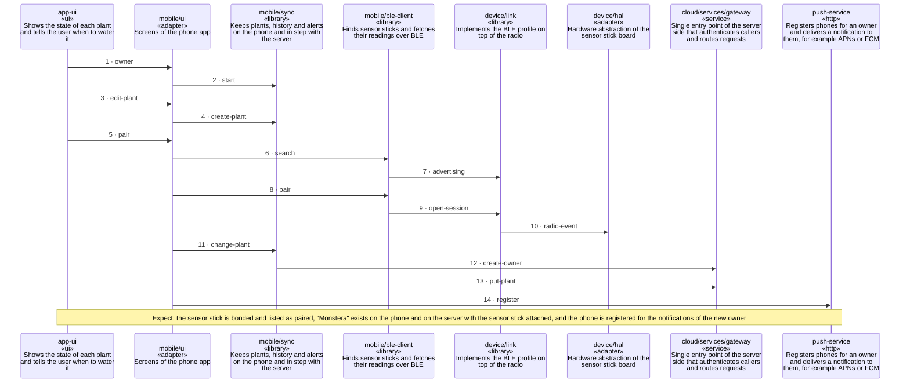

<!-- unifold:generated - do not edit; run `unifold generate` -->
# Scenario: first-plant

**plantwatch** · [README](../../README.md) · [component](component.md) · [architecture](architecture.md)

**An owner starts the app, adds a plant, pairs a sensor stick and binds it to the plant**
Source: tutorial first-plant of mobile
Expect: the sensor stick is bonded and listed as paired, "Monstera" exists on the phone and on the server with the sensor stick attached, and the phone is registered for the notifications of the new owner

A unit is named by its path from `plantwatch`; a capability or need of `plantwatch` is named bare. Every hop is a call along one connection of the map.

| # | Caller | Target | Part | Contract |
|---|---|---|---|---|
| 1 | `app-ui` | `mobile/ui` | `owner` | [app-ui](../references/app-ui.md) |
| 2 | `mobile/ui` | `mobile/sync` | `start` | [index](../../mobile/docs/references/plant-data/index.md) |
| 3 | `app-ui` | `mobile/ui` | `edit-plant` | [app-ui](../references/app-ui.md) |
| 4 | `mobile/ui` | `mobile/sync` | `create-plant` | [index](../../mobile/docs/references/plant-data/index.md) |
| 5 | `app-ui` | `mobile/ui` | `pair` | [app-ui](../references/app-ui.md) |
| 6 | `mobile/ui` | `mobile/ble-client` | `search` | [pairing](../../mobile/docs/references/pairing.md) |
| 7 | `mobile/ble-client` | `device/link` | `advertising` | [index](../references/ble-profile/index.md) |
| 8 | `mobile/ui` | `mobile/ble-client` | `pair` | [pairing](../../mobile/docs/references/pairing.md) |
| 9 | `mobile/ble-client` | `device/link` | `open-session` | [index](../references/ble-profile/index.md) |
| 10 | `device/link` | `device/hal` | `radio-event` | [radio](../../device/docs/references/radio.md) |
| 11 | `mobile/ui` | `mobile/sync` | `change-plant` | [index](../../mobile/docs/references/plant-data/index.md) |
| 12 | `mobile/sync` | `cloud/services/gateway` | `create-owner` | [index](../references/public-api/index.md) |
| 13 | `mobile/sync` | `cloud/services/gateway` | `put-plant` | [index](../references/public-api/index.md) |
| 14 | `mobile/ui` | `push-service` | `register` | [push-service](../references/push-service.md) |
