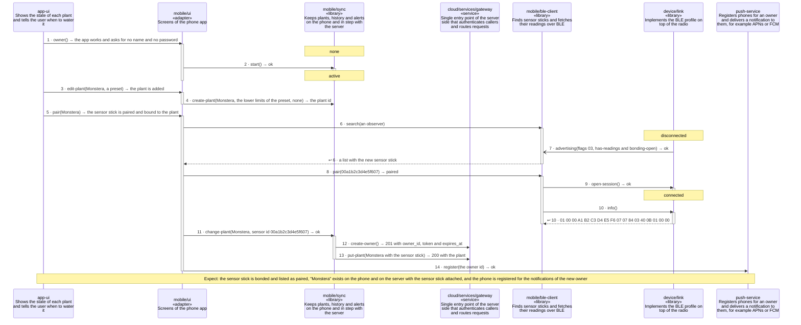

<!-- unifold:generated - do not edit; run `unifold check --fix` -->
# Scenario: first-plant

**plantwatch** · [README](../../README.md) · [component](component.md) · [architecture](architecture.md)

**An owner starts the app, adds a plant, pairs a sensor stick and binds it to the plant**
Source: tutorial first-plant of mobile
Expect: the sensor stick is bonded and listed as paired, "Monstera" exists on the phone and on the server with the sensor stick attached, and the phone is registered for the notifications of the new owner

A unit is named by its path from `plantwatch`; a capability or need of `plantwatch` is named bare. Every step is one hop along one connection of the map, drawn as the kind of its part says: a command or query goes from the caller to the target, and a dashed arrow brings the result of a query back; an event goes from the provider that raises it to the caller that receives it, with an open arrowhead. A bar is the time a lifeline is busy with a step; it ends when a lifeline further out makes the next step, and a unit below the busy one acts for it. An event from an idle lifeline lands on the bar of a busy receiver, or starts one. A step shows its result; a note on a provider's lifeline shows the state of a connection whose contract has states.

| # | Caller | Target | Call | Kind | Result | State | Contract |
|---|---|---|---|---|---|---|---|
| 1 | `app-ui` | `mobile/ui` | `owner()` | command | the app works and asks for no name and no password |  | [app-ui](../references/app-ui.md) |
| 2 | `mobile/ui` | `mobile/sync` | `start()` | command | ok | active | [plant-data](../../mobile/docs/references/plant-data/index.md) |
| 3 | `app-ui` | `mobile/ui` | `edit-plant(Monstera, a preset)` | command | the plant is added |  | [app-ui](../references/app-ui.md) |
| 4 | `mobile/ui` | `mobile/sync` | `create-plant(Monstera, the lower limits of the preset, none)` | command | the plant id | active | [plant-data](../../mobile/docs/references/plant-data/index.md) |
| 5 | `app-ui` | `mobile/ui` | `pair(Monstera)` | command | the sensor stick is paired and bound to the plant |  | [app-ui](../references/app-ui.md) |
| 6 | `mobile/ui` | `mobile/ble-client` | `search(an observer)` | query | a list with the new sensor stick |  | [pairing](../../mobile/docs/references/pairing.md) |
| 7 | `mobile/ble-client` | `device/link` | `advertising(flags 03, has-readings and bonding-open)` | event | ok | disconnected | [ble-profile](../references/ble-profile/index.md) |
| 8 | `mobile/ui` | `mobile/ble-client` | `pair(00a1b2c3d4e5f607)` | command | paired |  | [pairing](../../mobile/docs/references/pairing.md) |
| 9 | `mobile/ble-client` | `device/link` | `open-session()` | command | ok | connected | [ble-profile](../references/ble-profile/index.md) |
| 10 | `mobile/ble-client` | `device/link` | `info()` | query | 01 00 00 A1 B2 C3 D4 E5 F6 07 07 84 03 40 0B 01 00 00 | connected | [ble-profile](../references/ble-profile/index.md) |
| 11 | `mobile/ui` | `mobile/sync` | `change-plant(Monstera, sensor id 00a1b2c3d4e5f607)` | command | ok | active | [plant-data](../../mobile/docs/references/plant-data/index.md) |
| 12 | `mobile/sync` | `cloud/services/gateway` | `create-owner()` | command | 201 with owner_id, token and expires_at |  | [public-api](../references/public-api/index.md) |
| 13 | `mobile/sync` | `cloud/services/gateway` | `put-plant(Monstera with the sensor stick)` | command | 200 with the plant |  | [public-api](../references/public-api/index.md) |
| 14 | `mobile/ui` | `push-service` | `register(the owner id)` | command | ok |  | [push-service](../references/push-service.md) |
