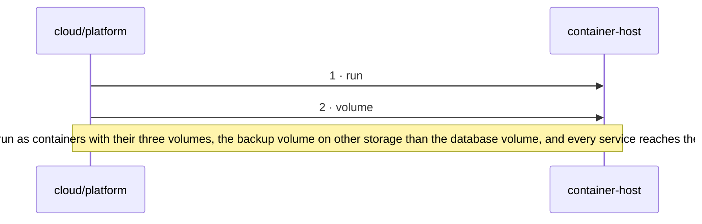

<!-- unifold:generated - do not edit; run `unifold generate` -->
# Scenario: start-the-server-side

**plantwatch** · [README](../../README.md) · [component](component.md) · [architecture](architecture.md)

**The container host starts the server side**
Source: deployment of cloud
Expect: the bus and the database run as containers with their three volumes, the backup volume on other storage than the database volume, and every service reaches them by name on the private network

A unit is named by its path from `plantwatch`; a capability or need of `plantwatch` is named bare. Every hop is a call along one connection of the map.

| # | Caller | Target | Part | Contract |
|---|---|---|---|---|
| 1 | `cloud/platform` | `container-host` | `run` | [container-host](../references/container-host.md) |
| 2 | `cloud/platform` | `container-host` | `volume` | [container-host](../references/container-host.md) |
